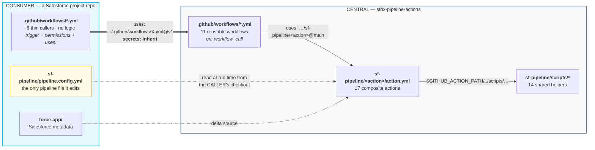
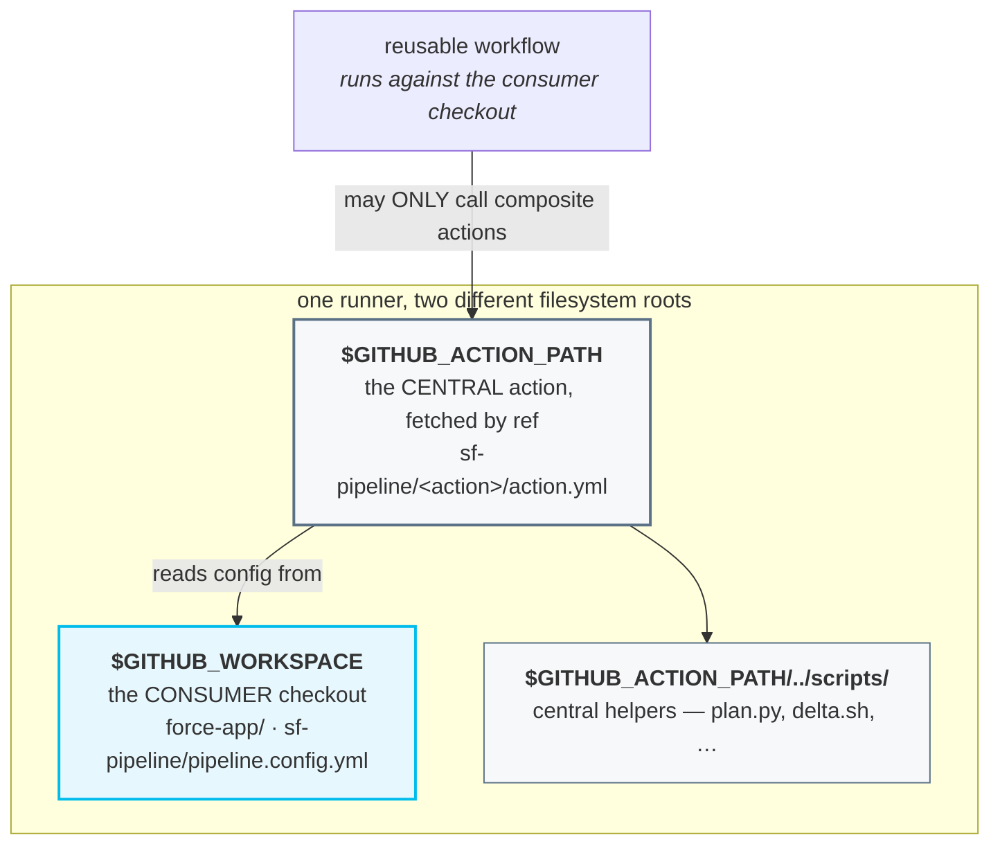
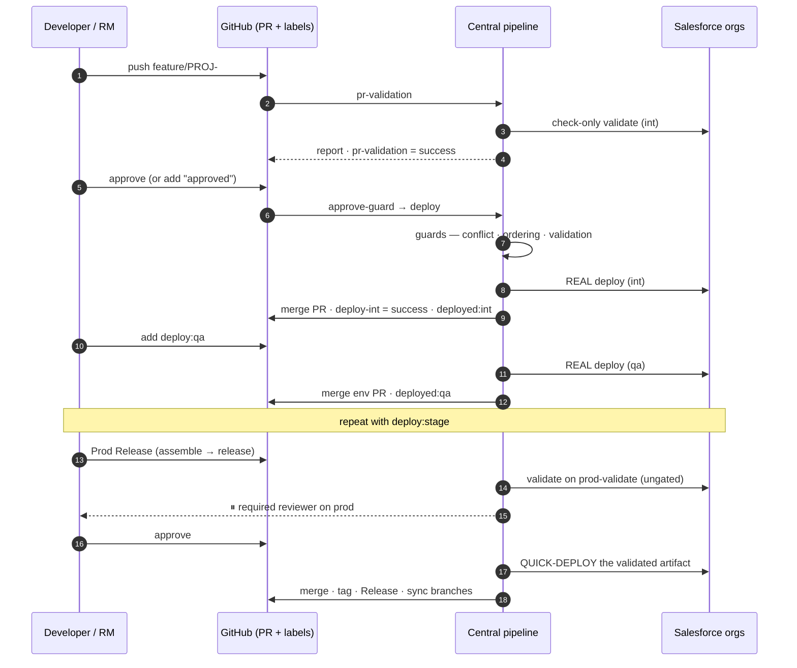
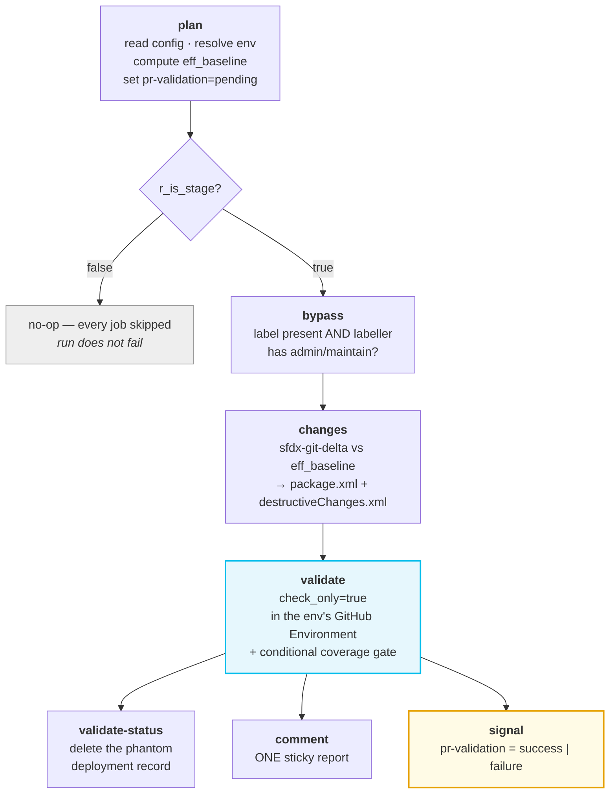
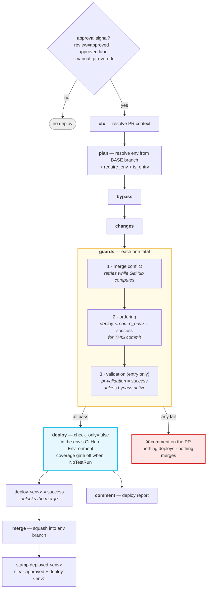
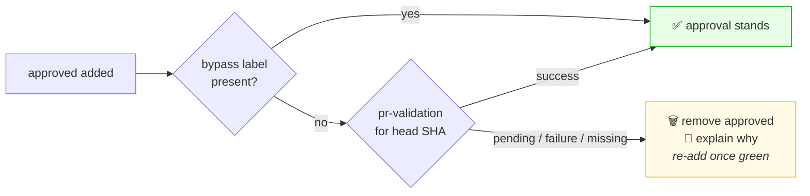
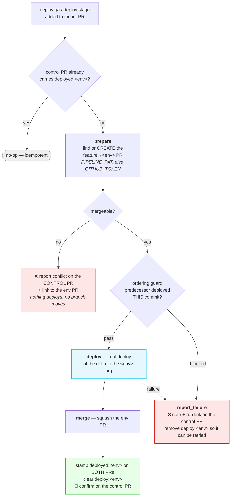
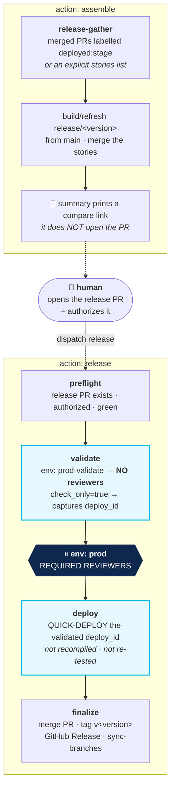
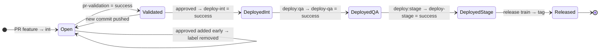

# Salesforce DevOps Pipeline — Product Documentation

**The complete technical reference.** Architecture, branching strategy, control
flow, configuration, internals and operations for the config-driven Salesforce
DevOps pipeline built on GitHub Actions.

> **Looking for how to *use* it?** See **[Pipeline_User_Guide.md](./Pipeline_User_Guide.md)**
> for step-by-step instructions. This document explains how the product works and
> why it is shaped the way it is.

**Scope.** This describes the GitHub Actions pipeline platform. There is **no
Salesforce-side application** — GitHub Actions is the entire product. Everything
below is drawn from committed source in `your-org/sfdx-pipeline-actions`
and the reference consumer `your-org/sfdx-pipeline-example`, and was confirmed by an
end-to-end run (acme PRs #186 → #187 → #188).

---

## Table of contents

| § | Section |
|---|---|
| 1 | [What this product is](#1-what-this-product-is) |
| 2 | [System architecture](#2-system-architecture) |
| 3 | [Portability — how cross-repo path resolution works](#3-portability--how-cross-repo-path-resolution-works) |
| 4 | [Branching strategy](#4-branching-strategy) |
| 5 | [Environments, orgs and secrets](#5-environments-orgs-and-secrets) |
| 6 | [Configuration reference](#6-configuration-reference) |
| 7 | [End-to-end flow](#7-end-to-end-flow) |
| 8 | [Stage 1 — PR validation](#8-stage-1--pr-validation) |
| 9 | [Stage 2 — approval deploy](#9-stage-2--approval-deploy-deploy-then-merge) |
| 10 | [Stage 3 — label-driven promotion](#10-stage-3--label-driven-promotion) |
| 11 | [Stage 4 — production release train](#11-stage-4--production-release-train) |
| 12 | [Label and commit-status state machine](#12-label-and-commit-status-state-machine) |
| 13 | [Delta computation and baselines](#13-delta-computation-and-baselines) |
| 14 | [Profiles and permission sets](#14-profiles-and-permission-sets) |
| 15 | [Quality gates and coverage](#15-quality-gates-and-coverage) |
| 16 | [Audit trail](#16-audit-trail) |
| 17 | [Notifications](#17-notifications) |
| 18 | [Ops runbooks](#18-ops-runbooks) |
| 19 | [Org bootstrap and onboarding](#19-org-bootstrap-and-onboarding) |
| 20 | [Workflow and action catalogue](#20-workflow-and-action-catalogue) |
| 21 | [Scripts reference](#21-scripts-reference) |
| 22 | [Concurrency map](#22-concurrency-map) |
| 23 | [Verified end-to-end run](#23-verified-end-to-end-run) |
| 24 | [Versioning and distribution](#24-versioning-and-distribution) |
| A | [Appendix A — diagram sources](#appendix-a--diagram-sources) |
| B | [Appendix B — known documentation drift](#appendix-b--known-documentation-drift) |

---

## 1. What this product is

One copy of a Salesforce CI/CD pipeline, written once and consumed by many
Salesforce project repositories.

A consuming project gets PR validation, a gated deploy to its entry org, a
label-driven promotion chain, a reviewer-gated production release train, and a set
of day-2 operational runbooks — **without copying any pipeline logic**. It
contributes three things and nothing more:

| The project owns | The pipeline owns |
|---|---|
| `.github/workflows/*.yml` — thin callers: a trigger, permissions, and a `uses:` | All reusable workflows, composite actions and scripts |
| `sf-pipeline/pipeline.config.yml` — the single edit surface | How that config is interpreted |
| `force-app/` — the Salesforce metadata being shipped | How a delta is computed, validated, deployed and recorded |

### Capability matrix

| Capability | Where it runs | Gate |
|---|---|---|
| PR validation (check-only) | entry env | automatic on PR open/update |
| Quality gates — PMD, Sonar, Apex coverage | entry env | conditional on the delta |
| Deploy to entry org (`int`) | `int` | PR approval or `approved` label |
| Promotion to `qa` / `stage` | `qa`, `stage` | `deploy:<env>` label + ordering guard |
| Production release | `prod-validate` → `prod` | required reviewers on `prod` |
| Recreate / redeploy / rollback | any | `workflow_dispatch` |
| Org bootstrap | new org | `workflow_dispatch` |

---

## 2. System architecture




### The contract

1. **Logic flows one way.** A caller contributes a trigger and a config file. It
   never contains pipeline logic.
2. **`secrets: inherit`** — the central workflows never hold credentials. They run
   with the *consumer's* secrets, scoped by GitHub Environment.
3. **Config is read from the caller's checkout at run time**, so the same central
   code behaves differently per project without branching.
4. **Consumers pin a released tag.** `v1` is published and is the ref every
   consumer should use — see [§24](#24-versioning-and-distribution).

### The one permitted exception

GitHub parses a workflow's `on:` block *before* any job runs, so it cannot read
`pipeline.config.yml`. Branch filters must therefore be **static literals** in the
caller. This is the only value duplicated outside the config file.

---

## 3. Portability — how cross-repo path resolution works

This is the load-bearing design constraint of the whole platform, and the reason
the directory layout is not arbitrary.

| Kind | Where its code runs | How it reaches its helpers |
|---|---|---|
| **Reusable workflow** (`on: workflow_call`) | in the **caller's** checkout | **Must not** touch `sf-pipeline/scripts/*` — those files do not exist in the consumer repo |
| **Composite action** (`uses: owner/repo/path@ref`) | fetched to its **own** path | `$GITHUB_ACTION_PATH/../scripts/…` — resolves inside the central repo, no checkout required |



**Consequence:** any new shared logic must be added as a composite action, or
inside an existing one. A reusable workflow that shells out to a script path
directly will work in the central repo's own tests and fail in every consumer.

### Environment-name independence

The second half of portability is that this platform has **no opinion about what
you call your environments**. `int → qa → stage` is a worked example, not a
contract. A project whose chain is `mon → tue → wed → thu → prod` changes
`pipeline.config.yml` and nothing else.

This holds because environment names are never written into pipeline logic. They
are read from the config at run time and flow outward:

| Derived thing | Derived from |
|---|---|
| Git branch for a stage | `environments[].branch` |
| GitHub Environment (secrets) | `environments[].gh_environment`, defaulting to `name` |
| Promotion label | `deploy:<name>` |
| Deployment stamp label | `deployed:<name>` |
| Commit status context | `deploy-<name>` |
| Which stage is the entry point | `environments[0]` |
| Which stage precedes a given one | list order |
| Label the release train gathers by | `release_label`, defaulting to `deployed:<last name>` |

Two properties matter for anyone extending this:

1. **`name` and `branch` are independent.** A stage may be called `qa` and live
   on branch `gh-actions-qa`. Any code that treats one as the other is a bug —
   see the `resolve` vs `prdeploy` note in §6.
2. **Chain length is not fixed.** One environment is valid (it is simultaneously
   the entry and last stage); so is ten. Nothing assumes three.

**The single unavoidable exception** is the `on: pull_request: branches:` filter
in the consumer's `pr-validation.yml` caller. GitHub evaluates `on:` filters
before any job exists, so that filter cannot read the config. It is the one
environment name a consumer writes outside `pipeline.config.yml`, and the example
caller flags it in a comment.

`tests/test_config_matrix.py` enforces all of this, driving `plan.py` with
non-standard names, with `branch != name`, and with a single-environment chain.
It runs in CI and in `scripts/validate.sh`.

---

## 4. Branching strategy


Environment branches are **long-lived**, never recreated. Feature branches are
short-lived and named for their tracker key.

```mermaid
flowchart LR
    F["feature/PROJ-###<br/><i>short-lived</i>"]
    I["<b>int</b><br/>entry · gate: approval"]
    Q["<b>qa</b><br/>gate: approval"]
    S["<b>stage</b><br/>gate: approval"]
    R["release/YYYY.WW<br/><i>cut from main</i>"]
    M["<b>main</b><br/>production baseline"]

    F -->|"PR + validate<br/>+ approve → deploy"| I
    I -.->|"deploy:qa label<br/>on the int PR"| Q
    Q -.->|"deploy:stage label<br/>on the int PR"| S
    S -->|"release-gather<br/>deployed:stage"| R
    R -->|"validate → reviewer<br/>→ quick-deploy"| M
    M -.->|"sync-env-branches<br/>after go-live"| I

    style M fill:#0D274D,stroke:#0D274D,color:#fff
    style I fill:#E6F7FD,stroke:#00BCEB,stroke-width:2px
    style Q fill:#E6F7FD,stroke:#00BCEB,stroke-width:2px
    style S fill:#E6F7FD,stroke:#00BCEB,stroke-width:2px
    style R fill:#fffbe6,stroke:#e6a100
    style F fill:#fff,stroke:#5B7186
```



### There is no promotion branch

Note the **dotted** qa/stage arrows. The feature branch is deployed *directly* to
each org. The label on the int PR only **orchestrates** — the delta deployed is
always the feature's own. This is why a change can be in `qa` without `qa` having
merged anything from `int`.

### Branch protection

Applied by `sf-pipeline/scripts/setup-branch-protection.sh` (idempotent, reads
branch names from the config):

| Branch | Protection |
|---|---|
| **entry** (`environments[0].branch`) | PR-only · required approvals · required checks `quality` + `validate` · stale reviews dismissed · conversation resolution · no force-push · no deletion |
| **downstream + prod** (`qa`, `stage`, `main`) | Guard-rails: no force-push, no deletion, plus the `deploy-<env>` status required before a promotion PR can merge |

`enforce_admins` defaults to **false** so an admin keeps an escape hatch — GitHub
forbids approving your own PR, and the post-approval auto-merge still has to
complete. Set `ENFORCE_ADMINS=true` for a real multi-developer team.

---

## 5. Environments, orgs and secrets

| Environment | Branch | GitHub Environment | Reviewers | Test level | How a change arrives |
|---|---|---|---|---|---|
| int | `int` | `int` | no | `RunSpecifiedTests` | PR approved → real deploy → merge |
| qa | `qa` | `qa` | optional | `NoTestRun` | `deploy:qa` label on the int PR |
| stage | `stage` | `stage` | optional | `NoTestRun` | `deploy:stage` label on the int PR |
| prod (validate) | `main` | `prod-validate` | **no** | `RunSpecifiedTests` | check-only, unattended |
| prod (deploy) | `main` | `prod` | **yes** | quick-deploy | reviewer-gated release train |

### Why credentials live in GitHub Environments

Each GitHub Environment holds exactly one org's JWT secrets:

| Secret | Meaning |
|---|---|
| `SF_CONSUMER_KEY` | Connected-app consumer key (client id) |
| `SF_USERNAME` | Integration user for that org |
| `SF_INSTANCE_URL` | Login / My Domain URL |
| `SF_JWT_KEY` | **base64-encoded** `server.key` |

Because `jobs.<id>.environment` accepts an expression, the *same* workflow file
can target any org — the environment name is resolved from config at run time and
GitHub injects that org's four secrets. Adding a sixth org is a config edit plus a
new GitHub Environment, not a code change.

### Why production is split across two environments

`prod-validate` has **no** reviewers; `prod` has required reviewers. If a single
environment carried both, the reviewer would be paged *before* the hours-long
validation began — asked to approve something nobody had tested yet. Splitting
them lets validation run unattended and pages a human only once the release is
provably deployable.

### Optional repo-level secrets

`PIPELINE_PAT` (PR creation where Actions is forbidden from opening PRs),
`CHAT_API_TOKEN`, `CHAT_CHANNEL_ID`, `CHAT_WEBHOOK_URL`,
`SONAR_TOKEN`, `SONAR_HOST_URL`,
`JIRA_BASE_URL`, `JIRA_EMAIL`, `JIRA_API_TOKEN`.

---

## 6. Configuration reference

`sf-pipeline/pipeline.config.yml` in the **consumer** repo is the single edit
surface. It is read at run time by the `plan` composite action
(`sf-pipeline/scripts/plan.py`).

### Top-level keys

| Key | Default | Meaning |
|---|---|---|
| `source_path` | `force-app` | Root of the sfdx-format metadata |
| `api_version` | — | Metadata API version used for the delta package |
| `node_version` | — | Node version for the CLI and LWC Jest |
| `baseline_branch` | `main` | The branch representing production; the release train merges here |
| `delta_baseline` | `prod` | Which ref the delta is computed against — see §13 |
| `org.prod_org` | — | Production My Domain base (before `--sandbox`) |
| `org.username_base` | — | Integration user; sandboxes append `.{sandbox}` |
| `environments[]` | — | The promotion chain, in order. First entry is the entry stage |
| `production.*` | — | Prod branch, the gated/ungated environments, targeting mode |
| `quality_gates.*` | all `true` | `pmd`, `sonar`, `apex_coverage` |
| `coverage_threshold` | `75` | Minimum aggregate Apex coverage % |
| `profiles_mode` | `full` | `full` or `incremental` — see §14 |
| `bypass_label` | — | Label an **admin** can add to bypass quality gates |
| `require_pr_approval` | `true` | Whether a reviewer approval is required at the entry stage |
| `notifications.chat` / `.jira` | — | Toggle each integration |

### Per-environment keys

| Key | Meaning |
|---|---|
| `name` | Logical stage name used in logs and labels |
| `branch` | The git branch mapped to this org |
| `gh_environment` | The GitHub Environment holding this org's secrets |
| `sandbox` | The **real** sandbox name (defaults to `name`) |
| `gate` | `auto` · `approval` · `on_demand` |
| `test_level` | `RunSpecifiedTests` · `RunLocalTests` · `NoTestRun` · … |

### Gate semantics

| Gate | Behaviour |
|---|---|
| `auto` | Feature PR → real deploy + auto-merge, no approval |
| `approval` | PR → check-only validation + report; approval (or the `approved` label) triggers the real deploy + merge |
| `on_demand` | Not PR-driven; deployed via the promotion label or a manual runbook |

**Gate defaults (`plan.py` → `normalize_envs`).** When `gate:` is omitted:

- `environments[0]` falls back to `require_pr_approval` — `approval` if true, `auto` if false.
- Every later environment defaults to `on_demand`.
- An unrecognised value coerces to `on_demand`.

### Production targeting — three modes

| Mode | Keys | Resolves to |
|---|---|---|
| **A — sandbox as prod** (training / lower envs) | `is_sandbox: true` + `sandbox: <name>` | `https://{prod_org}--{sandbox}.sandbox.my.salesforce.com`, user `{username_base}.{sandbox}` |
| **B — real production org** | `is_sandbox: false` | `https://{prod_org}.my.salesforce.com`, user `{username_base}` |
| **C — explicit override** | `instance_url:` + `integration_username:` | Exactly what you specify |

Other production keys: `release_branch_prefix` (default `release/`), `test_level`,
`destructive_tests` (the canary — see §11), and `release_label`.

**`release_label`** is the label the release train gathers PRs by. It defaults to
`deployed:<last environment's name>`, so a project that renames its final
pre-production stage needs no change — the train follows the config. Set it
explicitly only if you stamp a label the pipeline did not generate.

### The `plan` action's three modes

| Mode | Input | Key outputs |
|---|---|---|
| `outputs` | — | The whole resolved config, including `eff_baseline`, `last_env` and `release_label` |
| `resolve` | a **branch** | branch → env; `r_is_stage` is true **only** for `auto` / `approval` gates |
| `promote` | an **env name** | Guard rails for a manual promotion; refuses PR-driven stages |
| `prdeploy` | an **env name** | `r_require_env` (the immediately preceding env, **regardless of its gate**), `r_is_entry`, `r_branch`, `r_next_*` |

> **`resolve` is keyed by branch; `promote` and `prdeploy` are keyed by name.**
> Passing an environment *name* to `resolve` silently returns nothing whenever
> `name != branch`, because `resolve` deliberately treats an unmapped branch as
> inert rather than an error. This distinction is covered by
> `tests/test_config_matrix.py`.

### Reference configuration

The maintained example is
[`sf-pipeline/pipeline.config.example.yml`](../sf-pipeline/pipeline.config.example.yml).
The live reference consumer is `sfdx-pipeline-example`, which sets:

```yaml
delta_baseline: target          # diff against the PR's target env branch
baseline_branch: main
environments:                   # all three gated on approval
  - { name: int,   branch: int,   gh_environment: int,   sandbox: acmeint, gate: approval, test_level: RunSpecifiedTests }
  - { name: qa,    branch: qa,    gh_environment: qa,    sandbox: acmeqa,  gate: approval, test_level: NoTestRun }
  - { name: stage, branch: stage, gh_environment: stage, sandbox: acmestg, gate: approval, test_level: NoTestRun }
production:
  branch: main
  deploy_environment: prod      # required reviewers
  validate_environment: prod-validate
  is_sandbox: true
  sandbox: acmeprod
quality_gates: { apex_coverage: true }
coverage_threshold: 85
profiles_mode: incremental
require_pr_approval: true
```

---

## 7. End-to-end flow




---

## 8. Stage 1 — PR validation

Runs on PR open/update into the entry branch. **Never deploys for real, never
merges.**



Three details that matter:

- **`eff_baseline`** — with `delta_baseline: target` the delta is computed against
  the PR's base branch, so the report describes *exactly* what the approval deploy
  will push. With `prod` every env diffs against `baseline_branch`.
- **Phantom-proofing** — a check-only run against a GitHub Environment creates a
  deployment record. `validate-status` marks it inactive and deletes it so it can
  never satisfy a downstream ordering guard. This is load-bearing, not cosmetic.
- **`pr-validation` commit status** is the durable output. Both the approval guard
  and the entry-stage deploy guard key off it — not off job results.

---

## 9. Stage 2 — approval deploy (deploy-then-merge)




**The invariant:** the PR merges *only* after the org deploy succeeds, so an
environment branch never advances ahead of a real deployment.

### The three fatal guards

| # | Guard | Question | Notes |
|---|---|---|---|
| 1 | merge conflict | Is the PR mergeable? | Retries while GitHub is still computing mergeability — `UNKNOWN` is not a pass |
| 2 | ordering | Did the *previous* environment really deploy **this commit**? | Trusts **only** the `deploy-<env>` commit status |
| 3 | validation | Is `pr-validation` green for this head SHA? | Entry stage only; skipped when a bypass is active |

Guard 2 is why phantom deletion matters: a check-only run must never be mistakable
for a deploy.

### Approval guard

GitHub forbids approving your own PR, so on qa/stage a developer self-approves
with the `approved` label. Labels have no native preconditions — `approve-guard`
supplies one.



---

## 10. Stage 3 — label-driven promotion

The **int PR is the control surface**, even after it is merged and closed.



Key properties:

- **Idempotent** — re-adding a label that already produced a `deployed:<env>` is a
  no-op, so a retry cannot double-deploy.
- **Self-healing on failure** — a failed promotion removes `deploy:<env>` so the
  label can simply be re-added to retry.
- **`deployed:stage`** is the durable signal the release train later reads.

---

## 11. Stage 4 — production release train




> [!NOTE]
> **`assemble` deliberately stops short of opening the release PR.** It pushes the
> release branch and prints a pre-filled compare link. A human opens the PR, which
> forces someone to read the production change set. `preflight` then refuses to
> proceed unless that PR is **authorized** — approved by a *different* user, or
> carrying the **`prod-approved`** label. Since GitHub forbids self-approval, a
> solo operator must use the label.

**Validate-then-quick-deploy is the point.** Production is not recompiled or
re-tested after approval — the exact artifact validated against `prod-validate` is
the one promoted. *What a reviewer approves is what ships.*

**Destructive canary.** Salesforce forbids `NoTestRun` whenever Apex is involved,
including deletions. A destructive-only production change therefore runs the
configured `destructive_tests` canary rather than a whole, possibly red, org
suite. A deletion has no coverage requirement, so a single stable passing test
satisfies the platform. Blank falls back to `RunLocalTests`.

**Post-go-live sync.** `sync-branches` merges `main` into every env branch so the
next delta starts from what is live. A protected branch or a conflict degrades to
a sync PR; if the org blocks Actions from opening PRs it warns rather than failing
the release.

---

## 12. Label and commit-status state machine

The pipeline carries **no database**. Labels and commit statuses *are* the state.



### Markers

| Marker | Kind | Written by | Read by |
|---|---|---|---|
| `pr-validation` | commit status | pr-validation `signal` | approve-guard · entry deploy guard |
| `deploy-<env>` | commit status | **real deploy only** | ordering guard · branch protection |
| `approved` | label | human | deploy trigger · approve-guard |
| `deploy:<env>` | label | human | promotion trigger |
| `deployed:<env>` | label | pipeline | idempotency · release-gather |
| `bypass-quality-gates` | label | **admin only** | bypass action (permission re-verified at run time) |
| `prod-approved` | label | human, on the **release PR** | `release-preflight` — authorizes the production release |

Because the state lives on the PR, the int PR remains meaningful after merge — it
is the object the promotion labels are applied to and the object `release-gather`
queries.

---

## 13. Delta computation and baselines

Deltas are computed with **sfdx-git-delta** by the `changes` composite action,
producing a `package.xml` and, where relevant, a `destructiveChanges.xml`.

### `delta_baseline` — the two modes

| Mode | Behaviour | When to use |
|---|---|---|
| `target` | Each deploy/validation diffs against the PR's **target env branch** (int PR → `origin/int`, qa PR → `origin/qa`). The package is exactly what that environment is missing, so a QA package can legitimately differ from the INT package for the same story. | Environments can drift — e.g. hotfixes land straight into a higher env |
| `prod` *(default)* | Every environment diffs against `baseline_branch`. Every stage validates and deploys the identical prod-relative artifact. | Environments are kept in lockstep |

The resolved value surfaces as **`eff_baseline`** and is computed in both
`deploy.yml` and `pr-validation.yml`. The reference consumer `sfdx-pipeline-example`
uses `target`.

### Test selection

`sf-pipeline/scripts/specified_tests.py` resolves which Apex tests to run for
`RunSpecifiedTests`, so a delta that touches no Apex does not drag the whole org
suite into the run. `NoTestRun` on qa/stage is safe precisely because int already
validated with tests.

---

## 14. Profiles and permission sets

Controlled by `profiles_mode`, applied automatically by the `deploy` action via
`sf-pipeline/scripts/profiles.py`, which prints a "Profiles / Permission Sets"
block into the job summary.

| Mode | Behaviour | Trade-off |
|---|---|---|
| `full` *(default)* | Deploy the complete Profile / Permission Set from source | Safest when every referenced component already exists in the target org |
| `incremental` | For each profile/PS in the delta, keep only the permission entries that reference a component **also in this delta** (field, object, class, tab, app, recordType …), plus profile-level settings such as `userPermissions`. Everything else is stripped | Avoids "component does not exist" failures on orgs that lag behind |

The *Redeploy Feature Branch* runbook exposes a `profiles_mode` override for
one-off runs.

---

## 15. Quality gates and coverage

Three gates, each firing **only when the delta actually contains the relevant
components**, so unrelated PRs are not slowed down:

| Gate | Fires when | Enforced |
|---|---|---|
| `pmd` | `*.cls` / `*.trigger` change | Apex static analysis |
| `sonar` | Apex **or** LWC/Aura JS change | SonarQube scan (needs `SONAR_TOKEN`, `SONAR_HOST_URL`) |
| `apex_coverage` | `*.cls` / `*.trigger` change | During the org deploy, against `coverage_threshold` |

The coverage gate is implemented in `sf-pipeline/coverage/coverage-gate.py` and is
**skipped when the env's `test_level` is `NoTestRun`** — there is no coverage to
assess. A PR containing only metadata such as custom fields correctly skips it
entirely.

### Bypass

An admin can add `bypass_label` to skip the gates. The bypass is honoured **only
if the person who added the label has admin/maintain permission on the repo**,
re-verified at run time by the `bypass` action — the label alone is not authority.
An active bypass also causes the entry-stage validation guard to be skipped.

---

## 16. Audit trail

Every deploy / validate / promote / rollback records a structured entry via
`sf-pipeline/scripts/audit.py`:

1. A **🧾 Audit** table in the job summary — who, status, commit, components,
   profiles mode, coverage, deploy id, run link.
2. An `audit-record.json` uploaded with the `deploy-report-<env>` artifact.
3. For **real deploys only** (not check-only validations), one JSON line appended
   to the durable **`audit-log`** branch at `audit/audit-log.jsonl` — a permanent,
   greppable history. The append is best-effort and race-safe, so it can never
   fail a deploy.

```bash
git show audit-log:audit/audit-log.jsonl | jq 'select(.environment=="prod")'
```

---

## 17. Notifications

| Integration | Config | Secrets | Behaviour |
|---|---|---|---|
| **chat** | `notifications.chat` | `CHAT_API_TOKEN` + `CHAT_CHANNEL_ID`, or `CHAT_WEBHOOK_URL` | Posts deploy outcomes. **No-op when unconfigured** — never fails a run |
| **Jira** | `notifications.jira` | `JIRA_BASE_URL`, `JIRA_EMAIL`, `JIRA_API_TOKEN` | Links the story by the issue key in the branch name (e.g. `feature/PROJ-123-foo`); each deploy comments and transitions the story to that env's status |

Both are deliberately best-effort: a notification outage must not block a
deployment.

---

## 18. Ops runbooks

Four `workflow_dispatch` runbooks, all reusing the same config and composite
actions. They sit **alongside** the promotion chain, not inside it.

| Runbook | Purpose | Key inputs |
|---|---|---|
| **Recreate Feature Branch** | Cut a clean `feature/<name>` from the baseline when a branch is stale or corrupted | `name`, `base` (defaults to the pipeline baseline), `confirm_reset` (**required `true`** to reset an existing branch — destructive) |
| **Redeploy Feature Branch** | Idempotently (re)deploy a feature branch's delta to any environment, to retry a flaky deploy or re-validate after an org change. Does **not** move any env branch | `feature_ref`, `environment`, `dry_run` (**default true** = check-only), `profiles_mode` override |
| **Rollback** | Revert a deployed change and open a **revert PR** into the entry branch, so the rollback flows through the same gate → approve → deploy → merge path — fully validated, reviewed and audited. Nothing is force-deployed | `pr_number` (merge commits use `-m 1` automatically) **or** `ref`; `base` |
| **Sync env branches** | Merge `main` into every env branch after go-live | called by `prod-release`; also dispatchable |

A conflicting revert stops with manual `git revert` instructions rather than
guessing.

### Merging back to source sandboxes

Deployments flow **forward** through orgs, so developer sandboxes drift behind the
baseline. After a release, either refresh the sandbox from the promotion source
org in Salesforce Setup (cleanest for full parity), or cut a branch from the
baseline with *Recreate Feature Branch* and deploy it into the sandbox with
*Redeploy Feature Branch* (`dry_run=false`). Always start the next story's branch
from the baseline so its delta stays clean.

---

## 19. Org bootstrap and onboarding

`org-bootstrap.yml` plus the `sf-setup/` kit in the central repo automate standing
up a new org's connection: the connected app, the JWT certificate, the integration
user, and writing the four secrets into the consuming repo's GitHub Environment.

Step-by-step onboarding instructions live in
**[Pipeline_User_Guide.md](./Pipeline_User_Guide.md)**.

---

## 20. Workflow and action catalogue

### Reusable workflows — `.github/workflows/` (all `on: workflow_call`)

| Workflow | Purpose |
|---|---|
| `pr-validation.yml` | Check-only validation + quality gates + sticky report + `pr-validation` status |
| `deploy.yml` | The real deploy, guards, merge, status and label stamping. Serves int, qa and stage |
| `approve-guard.yml` | Holds the `approved` label until validation is green |
| `sf-promote-label.yml` | Label-driven promotion orchestration |
| `prod-release.yml` | `assemble` and `release` — the production train |
| `sync-env-branches.yml` | Replay `main` onto the env branches |
| `org-bootstrap.yml` | Stand up a new org's connection and secrets |
| `project-init.yml` | Create the branches, labels and GitHub Environments a config declares |
| `sf-ops-recreate-feature.yml` | Recreate runbook |
| `sf-ops-redeploy-feature.yml` | Redeploy runbook |
| `sf-ops-rollback.yml` | Rollback runbook |

> **No workflow in this repository triggers on `push` or `pull_request`.** All
> eleven are `workflow_call` only, so the central repo cannot self-trigger a
> deploy. (`ci.yml` is this repository's own static-check build and is not part
> of the consumer surface.)

### Composite actions — `sf-pipeline/<name>/action.yml`

| Action | Purpose |
|---|---|
| `plan` | Read the caller's config → outputs (`outputs` / `resolve` / `promote` / `prdeploy` modes) |
| `init` | Create the branches, labels and GitHub Environments the config declares |
| `changes` | Install SF CLI + sfdx-git-delta; compute the delta and manifest |
| `deploy` | auth → profiles → validate/deploy → coverage gate → report → audit |
| `guard` | The three fatal pre-deploy guards |
| `approval` | Interpret the approval signal |
| `bypass` | Resolve and **re-verify** an admin bypass |
| `merge-pr` | Squash-merge after a successful deploy |
| `report` | The unified sticky PR comment |
| `status` | Write `pr-validation` / `deploy-<env>` commit statuses |
| `coverage` | Apex coverage gate |
| `release-gather` | Collect the release label's PRs for a release (label from `release_label`) |
| `release-preflight` | Verify the release PR exists, is authorized and green |
| `sync-branches` | Merge `main` into env branches, degrading to a PR |
| `jira` · `notify` | Integrations (no-ops when unconfigured) |

---

## 21. Scripts reference

`sf-pipeline/scripts/` — reached by composite actions via
`$GITHUB_ACTION_PATH/../scripts/`.

| Script | Purpose |
|---|---|
| `plan.py` | The config resolution engine — `normalize_envs`, `cmd_outputs`, `cmd_resolve`, `cmd_promote`, `cmd_prdeploy` |
| `delta.sh` | sfdx-git-delta invocation and manifest assembly |
| `auth-jwt.sh` | JWT login to an org from the injected environment secrets |
| `install-sf.sh` | Install the SF CLI and plugins |
| `profiles.py` | `full` / `incremental` profile and permission-set handling |
| `specified_tests.py` | Resolve the Apex test list for `RunSpecifiedTests` |
| `coverage-gate.py` *(in `coverage/`)* | Enforce `coverage_threshold` |
| `deploy_report.py` | Build the deploy report body |
| `manifest_to_md.py` | Render `package.xml` as a Markdown component table |
| `audit.py` · `audit-append.sh` | Structured audit record and durable append to the `audit-log` branch |
| `jira.py` | Jira comment and transition |
| `dependency_lint.py` | Metadata dependency checks |
| `setup-branch-protection.sh` | Codified, idempotent branch protection |

---

## 22. Concurrency map

| Scope | Group | Effect |
|---|---|---|
| PR validation | `pr-validation-<pr>` | A new push supersedes the in-flight validation |
| Deploy | per environment | Serialises deploys into the same org |
| Promotion | per PR + env | Prevents a double promotion from a re-added label |
| Release | per release branch | One train at a time |

> ⚠️ **Caller gotcha.** A caller must **not** declare a concurrency group equal to
> the reusable workflow's own (e.g. `pr-validation-<pr>`). It cancels itself and
> produces a run with **zero jobs**. This is documented inline in the reference
> consumer's `pr-validation.yml`.

---

## 23. Verified end-to-end run

The behaviour documented here was confirmed end-to-end in `sfdx-pipeline-example`,
**including production**, by shipping two real custom fields on `Release_Note__c`
(`Prod_E2E_Check__c`, `Prod_E2E_Released_On__c`) from a developer branch all the
way into `acmeprod`.

| Stage | Org | PR / run | Result |
|---|---|---|---|
| PR validation | acmeint *(check-only)* | #189 → `int` | 2 CustomFields detected; coverage gate correctly **skipped** (no Apex); `pr-validation = success`; phantom deployment cleaned up |
| Approval deploy | **acmeint** | #189 | approve-guard fired; full chain ran (ctx → plan → changes → bypass → guards → real deploy → comment → merge); `deploy-int = success`; `deployed:int` |
| Promote to qa | **acmeqa** | #190 *(auto-created)* | Ordering guard passed; deployed; merged; `deployed:qa` |
| Promote to stage | **acmestg** | #191 *(auto-created)* | Ordering guard passed; deployed; merged; `deployed:stage` |
| Assemble | — | run `…785553` | `release-gather` collected the 3 unshipped stories and skipped everything already released; pushed `release/2026.38` |
| Preflight (unauthorized) | — | run `…926858` | ✅ **Correctly refused** — *"Release PR #192 is not authorized"*. Nothing validated, nothing deployed |
| Release | **acmeprod** | #192 | preflight → validate (ungated `prod-validate`) → ⏸ **prod reviewer gate** → quick-deploy → merge → tag `v2026.38` → GitHub Release → env-branch sync |

**Post-conditions verified:**

- `main` carries both new fields; `int`, `qa` and `stage` are all at exactly
  `main` (0 ahead / 0 behind) after the automatic sync.
- Tag `v2026.38` and its GitHub Release exist.
- The durable `audit-log` branch gained one line per real deploy —
  `int` · `qa` · `stage` · **`prod`**, all `status=success`.
- The production job genuinely paused for its required reviewer and only
  quick-deployed the already-validated artifact after approval.

### Two findings from the run

1. **`assemble` does not open the release PR** *(by design)* — it prints a compare
   link. The documentation previously implied otherwise and has been corrected.
2. **A transient GitHub GraphQL 500** broke the first `deploy:stage` promotion
   while creating the env PR. The pipeline degraded correctly: it commented the
   exact error on the control PR, deployed nothing and moved no branch. However,
   unlike the merge-conflict path, this path **leaves the `deploy:<env>` label in
   place**, so re-adding it does not retrigger — an operator must remove and
   re-add it. Worth aligning with the conflict path.

### Second verified run — the `@v1` migration (2026.42)

A second full chain was run end-to-end, carrying the migration of all 8 caller
workflows from `@main` to the released **`@v1`** tag, plus one field
(`Release_Note__c.Pipeline_Ref__c`) so every stage performed a real deploy.

Because GitHub runs `pull_request` workflows from the *merge commit*, this
promotion was orchestrated by **the very ref it was pinning** — `@v1` validated
itself against all three sandboxes and then production.

| Stage | Org | PR / run | Result |
|---|---|---|---|
| PR validation | acmeint *(check-only)* | #194 → `int` | 7/7 jobs green under `@v1` |
| Approval deploy | **acmeint** | #194 | 8/8 jobs; `deployed:int`; auto-merged |
| Promote to qa | **acmeqa** | #195 *(auto-created)* | deployed; merged; `deployed:qa` |
| Promote to stage | **acmestg** | #196 *(auto-created)* | deployed; merged; `deployed:stage` |
| Assemble | — | run `…193067` | pushed `release/2026.42` |
| Release *(first attempt)* | — | run `…396392` | ❌ **failed** — see below |
| Release *(after fix)* | **acmeprod** | #197 | preflight → validate → ⏸ reviewer gate → quick-deploy → merge → tag `v2026.42` → Release → env sync |

No retries were needed in the int → qa → stage chain. Afterwards all four
branches carry 8/8 `@v1` references and zero `@main`, and the `audit-log` branch
gained four more `status=success` entries with real Salesforce deploy ids.

### The finding: a chat notification could fail production

The first release attempt **failed in `prod / validate` before Salesforce was
ever contacted.** The cause was an expired chat bot token: `notify.sh`
exited 1 on any HTTP ≥ 300, and because the notify step runs *inside* the
validate job, a `401` from a chat API aborted the production release.

This contradicted the notify action's own contract — it is documented as a
**no-op when chat is not configured**, so notification was never intended to be
a gate. *Missing* credentials were tolerated while *bad* credentials were fatal.

Fixed in **v1.1.0**: notification is now never fatal. Every failure path emits a
GitHub `::warning` and exits 0 — `401`/`403`, `404`, any other non-2xx, network
errors and timeouts (capped at 30s) — and the previously unchecked webhook path
is handled too. Re-running the identical release then passed.

---

## 24. Versioning and distribution

### Releases

`v1.0.0` is the first released version. Its pipeline logic is **byte-identical**
to the build verified end-to-end against real orgs through to `acmeprod`
([§23](#23-verified-end-to-end-run)) — only documentation and internal refs
([below](#a-release-tag-must-rewrite-its-own-internal-refs)) changed between them.

| Ref | Kind | Behaviour |
|---|---|---|
| `@v1` | **moving major tag** | Advances on every backward-compatible release. **The recommended pin.** Currently resolves to v1.1.0 |
| `@v1.1.0` | immutable | Notification failures are never fatal |
| `@v1.0.0` | immutable | Frozen at an exact build, for reproducibility |
| `@main` | branch | Bleeding edge. Every commit lands in consumers instantly — **not for real projects** |

Breaking changes ship as `v2`; a consumer opts in by changing one character. The
`v1` tag is force-moved forward on each compatible release, so consumers receive
fixes without acting.

### A release tag must rewrite its own internal refs

> [!IMPORTANT]
> This is the single thing most likely to make a release silently meaningless.

The reusable workflows do not only *get* called — they also *call*. Every one of
them invokes this repository's composite actions, **45 such references** across the
ten workflows:

```yaml
# .github/workflows/deploy.yml, on main
- uses: your-org/sfdx-pipeline-actions/sf-pipeline/deploy@main
```

A consumer pinning `@v1` gets the *workflow file* frozen at `v1` — but if that file
still says `@main`, every action it calls resolves to the moving branch. The pin
would be cosmetic and the real deploy logic would keep floating.

GitHub does **not** allow expressions in `uses:`, so `@${{ github.ref }}` is not an
option. The fix is the standard action-monorepo pattern: **the release commit
rewrites the refs, and exists only on the tag.**

- `main` keeps `@main`, so day-to-day development is never frozen.
- The `v1` tag points at a commit whose 45 internal refs all read `@v1`.
- The `v1.0.0` tag points at a commit whose 45 internal refs all read `@v1.0.0`,
  making that pin genuinely immutable all the way down.

Verify any tag before trusting it:

```bash
git show v1:.github/workflows/deploy.yml \
  | grep -oE 'sfdx-pipeline-actions/[^@]+@[A-Za-z0-9.]+' \
  | sed 's|.*@||' | sort | uniq -c
#   12 v1          <- correct
#   12 main        <- BROKEN, the tag is floating
```

### Distribution — there is nothing to publish

| Channel | Status |
|---|---|
| **Public repository** | ✅ Any repository on GitHub can call these reusable workflows by slug. Nothing needs installing |
| **Private fork** | Set the Actions access policy to `organization` or `enterprise` so sibling repositories may call it |
| **GitHub Actions Marketplace** | ➖ Not applicable. The Marketplace lists *actions*, not reusable workflows; consumers reference these by `owner/repo/path@ref` |

For a private fork, verify or change the policy with:

```bash
gh api repos/<owner>/<repo>/actions/permissions/access
# {"access_level":"organization"}
```

> [!NOTE]
> Because distribution is a repository *setting* rather than an artifact push,
> "publishing" a new version means nothing more than moving the `v1` tag. There is
> no registry, no package, and no upload step.

### Migrating a consumer off `@main`

```bash
cd <your-sf-repo>
grep -rl 'sfdx-pipeline-actions/.*@main' .github/workflows/ \
  | xargs sed -i '' 's|\(sfdx-pipeline-actions/[^@]*\)@main|\1@v1|g'
```

Behaviour is unchanged on the day of the switch: the `v1` release commit is `main`
with nothing altered but its own internal refs. Note the caller workflows exist on
**every** branch, so the change must reach `int`, `qa`, `stage` and `main` to be
consistent — drive it through the normal promotion chain like any other change.

**`sfdx-pipeline-example` has completed this migration.** It was driven through the
normal promotion chain as release `2026.42`, so all four branches now carry 8/8
`@v1` references and zero `@main` ([§23](#23-verified-end-to-end-run)).

### Cutting the next release

Because each tag carries its own internal refs, a release is **two throwaway
commits off `main`**, not a plain `git tag`. Never tag `main` directly.

```bash
BASE=$(git rev-parse main)

# --- immutable patch tag: internals pinned to the exact version -------------
git checkout --detach $BASE
sed -i '' -E 's|(your-org/sfdx-pipeline-actions/[^@[:space:]]+)@main|\1@v1.1.0|g' \
  .github/workflows/*.yml
git commit -qam "release: pin internal action references to v1.1.0"
git tag -a v1.1.0 -m "Pipeline v1.1.0"

# --- moving major tag: internals pinned to @v1 ------------------------------
git checkout --detach $BASE
sed -i '' -E 's|(your-org/sfdx-pipeline-actions/[^@[:space:]]+)@main|\1@v1|g' \
  .github/workflows/*.yml
git commit -qam "release: pin internal action references to v1"
git tag -f -a v1 -m "Pipeline v1"

git checkout main
git push origin v1.1.0 && git push -f origin v1
gh release create v1.1.0 --notes-file notes.md --latest
```

Then verify the tag with the `git show` check above, and smoke-test it from a
consumer before announcing it (see below).

### Validating a release from a consumer

A tag is only proven once a real caller has run it. Open a throwaway PR into `int`
that pins the callers at the new tag **and** touches one metadata file, so the
delta is non-empty:

```bash
git checkout -b test/v1-pin-validation
grep -rl 'sfdx-pipeline-actions/.*@main' .github/workflows/ \
  | xargs sed -i '' -E 's|(sfdx-pipeline-actions/[^@[:space:]]+)@main|\1@v1|g'
# add or edit one field, then commit, push and open the PR against int
```

For a `pull_request` event GitHub runs the workflow from the **merge commit**, so
the edited callers are the ones that execute — the PR self-tests the tag. A green
`PR Validation` proves the tag resolves and performs a real check-only deploy.
Close the PR without merging to leave the consumer untouched.

---

## Appendix A — diagram sources

The five headline diagrams are maintained as editable **draw.io** files in
[`diagrams/`](./diagrams/), each with a rendered PNG beside it. The PNGs carry the
diagram XML embedded, so either file opens and edits in draw.io.

| # | Diagram | Source |
|---|---|---|
| 1 | System topology | `diagrams/01-system-topology.drawio` |
| 2 | Branches, environments and orgs | `diagrams/02-branch-environment-map.drawio` |
| 3 | End-to-end change lifecycle | `diagrams/03-change-lifecycle.drawio` |
| 4 | Inside a deploy (guards) | `diagrams/04-deploy-guards.drawio` |
| 5 | Production release train | `diagrams/05-prod-release-train.drawio` |

Regenerate a PNG with any draw.io export, keeping XML embedding on so the image
stays editable:

```bash
drawio -x -f png -e -b 10 -o diagrams/01-system-topology.png diagrams/01-system-topology.drawio
```

Colour convention: cyan `#00BCEB` = the consumer side and pipeline-orchestrated
hops · blue `#dae8fc` = a pipeline job or action · green `#d5e8d4` = something that
really changed an org or branch · amber `#fff2cc` = a gate, guard or decision ·
red `#f8cecc` = production and failure paths · grey `#f5f5f5` = inert or external.

The inline `mermaid` diagrams in this document render natively on GitHub and carry
the same content.

---

## Appendix B — known documentation drift

Recorded here so they are not silently re-derived. These are **documentation**
issues; no code defect is implied.

| # | Where | Issue |
|---|---|---|
| D1 | *(resolved)* | The README claimed the delta was *never* computed against the target branch. `delta_baseline` is real (`plan.py`, default `prod`) and is now documented and present in the example config |
| D2 | *(resolved)* | The example config was missing `delta_baseline`, the `org:` block and the production targeting mode, and claimed PMD/Sonar were configurable. Static analysis is genuinely out of scope — `quality_gates` only reads `apex_coverage` — and the phantom keys are gone |
| D3 | *(resolved)* | The previous `Product_Documentation.md` documented a **different project** (an unrelated earlier project) and contradicted the consumer contract. This rewrite replaces it |
| D4 | *(resolved)* | The setup guide named old filenames, the wrong caller count and `gh-actions-*` branches. Part 1 was rewritten against the shipped files, and `scripts/validate.sh` checks 8 and 10 now enforce the example set against the example config |
| D5 | *(resolved)* | The example `pr-validation.yml` trigger listed only the entry branch, so `plan.py`'s release-branch validation path was unreachable in a fresh consumer. The caller now also fires on `release/**`, and check 8 enforces it |

> **There were two example configs** — `sf-pipeline/pipeline.config.example.yml`
> and a second copy under `examples/consumer/` — and they had drifted apart in
> gates, branch names and phantom keys. The duplicate was deleted; the former is
> now the single template, and the README and guide both point at it.

### Open threads

1. ~~**Pipeline versioning**~~ — **done.** `v1.0.0`, `v1.1.0` and the moving `v1`
   tag are published, each with its internal refs correctly rewritten, and
   `sfdx-pipeline-example` has been migrated to `@v1` on all four branches through a
   full production release. See [§24](#24-versioning-and-distribution).
2. **Promotion retry asymmetry** — when a promotion fails *before* deploying, the
   `deploy:<env>` label is left in place, so re-adding it is a no-op. The
   merge-conflict path removes it. Align the two. *(Queued for v1.1.)*
3. **Runner cost and concurrency at enterprise scale** — research-shaped, and now
   the live question as more projects onboard.
4. **End-to-end onboarding of a brand-new project** via `org-bootstrap` — now
   unblocked, since `@v1` is stable.

Separately, the central workflows run `actions/checkout@v4`, `actions/setup-node@v4`
and `actions/upload-artifact@v4`, which log a Node 20 deprecation warning and are
force-run on Node 24. Not breaking today; worth folding into the versioning work.
