# Salesforce DevOps Pipeline — Product Documentation

**The complete technical reference.** Architecture, branching strategy, control
flow, configuration, internals and operations for the config-driven Salesforce
DevOps pipeline built on GitHub Actions.

> **Looking for how to *use* it?** See **[Pipeline_User_Guide.md](./Pipeline_User_Guide.md)**
> for step-by-step instructions. This document explains how the product works and
> why it is shaped the way it is.

**Scope.** This describes the GitHub Actions pipeline platform. There is **no
Salesforce-side application** — GitHub Actions is the entire product. Everything
below is drawn from committed source in `muraliseelam/sfdx-pipeline-actions`
and the reference consumer `your-org/sfdx-pipeline-example`, and was confirmed by an
end-to-end run (acme PRs #186 → #187 → #188).

---

## Table of contents

| § | Section |
|---|---|
| 1 | [What this product is](#1-what-this-product-is) |
| 2 | [System architecture](#2-system-architecture) |
| 3 | [Portability — how cross-repo path resolution works](#3-portability--how-cross-repo-path-resolution-works) |
| 4 | [Branching strategy](#4-branching-strategy) |
| 5 | [Environments, orgs and secrets](#5-environments-orgs-and-secrets) |
| 6 | [Configuration reference](#6-configuration-reference) |
| 7 | [End-to-end flow](#7-end-to-end-flow) |
| 8 | [Stage 1 — PR validation](#8-stage-1--pr-validation) |
| 9 | [Stage 2 — approval deploy](#9-stage-2--approval-deploy-deploy-then-merge) |
| 10 | [Stage 3 — label-driven promotion](#10-stage-3--label-driven-promotion) |
| 11 | [Stage 4 — production release train](#11-stage-4--production-release-train) |
| 12 | [Label and commit-status state machine](#12-label-and-commit-status-state-machine) |
| 13 | [Delta computation and baselines](#13-delta-computation-and-baselines) |
| 14 | [Profiles and permission sets](#14-profiles-and-permission-sets) |
| 15 | [Quality gates and coverage](#15-quality-gates-and-coverage) |
| 16 | [Audit trail](#16-audit-trail) |
| 17 | [Notifications](#17-notifications) |
| 18 | [Ops runbooks](#18-ops-runbooks) |
| 19 | [Org bootstrap and onboarding](#19-org-bootstrap-and-onboarding) |
| 20 | [Workflow and action catalogue](#20-workflow-and-action-catalogue) |
| 21 | [Scripts reference](#21-scripts-reference) |
| 22 | [Concurrency map](#22-concurrency-map) |
| 23 | [Verified end-to-end run](#23-verified-end-to-end-run) |
| 24 | [Versioning and distribution](#24-versioning-and-distribution) |
| A | [Appendix A — diagram sources](#appendix-a--diagram-sources) |
| B | [Appendix B — known documentation drift](#appendix-b--known-documentation-drift) |

---

## 1. What this product is

One copy of a Salesforce CI/CD pipeline, written once and consumed by many
Salesforce project repositories.

A consuming project gets PR validation, a gated deploy to its entry org, a
label-driven promotion chain, a reviewer-gated production release train, and a set
of day-2 operational runbooks — **without copying any pipeline logic**. It
contributes three things and nothing more:

| The project owns | The pipeline owns |
|---|---|
| `.github/workflows/*.yml` — thin callers: a trigger, permissions, and a `uses:` | All reusable workflows, composite actions and scripts |
| `sf-pipeline/pipeline.config.yml` — the single edit surface | How that config is interpreted |
| `force-app/` — the Salesforce metadata being shipped | How a delta is computed, validated, deployed and recorded |

### Capability matrix

| Capability | Where it runs | Gate |
|---|---|---|
| PR validation (check-only) | entry env | automatic on PR open/update |
| Quality gates — PMD, Sonar, Apex coverage | entry env | conditional on the delta |
| Deploy to entry org (`int`) | `int` | PR approval or `approved` label |
| Promotion to `qa` / `stage` | `qa`, `stage` | `deploy:<env>` label + ordering guard |
| Production release | `prod-validate` → `prod` | required reviewers on `prod` |
| Recreate / redeploy / rollback | any | `workflow_dispatch` |
| Org bootstrap | new org | `workflow_dispatch` |

---

## 2. System architecture

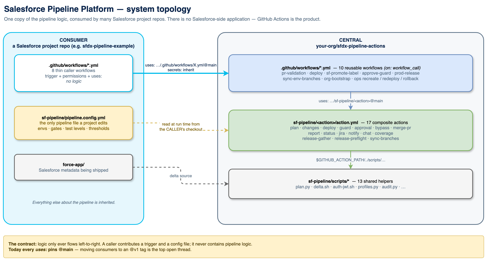


### The contract

1. **Logic flows one way.** A caller contributes a trigger and a config file. It
   never contains pipeline logic.
2. **`secrets: inherit`** — the central workflows never hold credentials. They run
   with the *consumer's* secrets, scoped by GitHub Environment.
3. **Config is read from the consumer repo at run time**, so the same central
   code behaves differently per project without branching. For a pull request
   the gates and environments come from the PR's **base** branch (if protected,
   else the default branch), never from the PR's own copy — see
   [§6](#where-the-config-is-read-from).
4. **Consumers pin a released tag.** `v1` is published and is the ref every
   consumer should use — see [§24](#24-versioning-and-distribution).

### The one permitted exception

GitHub parses a workflow's `on:` block *before* any job runs, so it cannot read
`pipeline.config.yml`. Branch filters must therefore be **static literals** in the
caller. This is the only value duplicated outside the config file.

---

## 3. Portability — how cross-repo path resolution works

This is the load-bearing design constraint of the whole platform, and the reason
the directory layout is not arbitrary.

| Kind | Where its code runs | How it reaches its helpers |
|---|---|---|
| **Reusable workflow** (`on: workflow_call`) | in the **caller's** checkout | **Must not** touch `sf-pipeline/scripts/*` — those files do not exist in the consumer repo |
| **Composite action** (`uses: owner/repo/path@ref`) | fetched to its **own** path | `$GITHUB_ACTION_PATH/../scripts/…` — resolves inside the central repo, no checkout required |

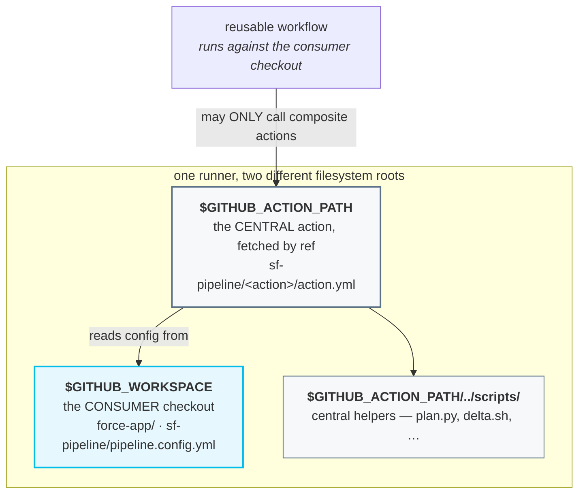

**Consequence:** any new shared logic must be added as a composite action, or
inside an existing one. A reusable workflow that shells out to a script path
directly will work in the central repo's own tests and fail in every consumer.

### Environment-name independence

The second half of portability is that this platform has **no opinion about what
you call your environments**. `int → qa → stage` is a worked example, not a
contract. A project whose chain is `mon → tue → wed → thu → prod` changes
`pipeline.config.yml` and nothing else.

This holds because environment names are never written into pipeline logic. They
are read from the config at run time and flow outward:

| Derived thing | Derived from |
|---|---|
| Git branch for a stage | `environments[].branch` |
| GitHub Environment (secrets) | `environments[].gh_environment`, defaulting to `name` |
| Promotion label | `deploy:<name>` |
| Deployment stamp label | `deployed:<name>` |
| Commit status context | `deploy-<name>` |
| Which stage is the entry point | `environments[0]` |
| Which stage precedes a given one | list order |
| Label the release train gathers by | `release_label`, defaulting to `deployed:<last name>` |

Two properties matter for anyone extending this:

1. **`name` and `branch` are independent.** A stage may be called `qa` and live
   on branch `gh-actions-qa`. Any code that treats one as the other is a bug —
   see the `resolve` vs `prdeploy` note in §6.
2. **Chain length is not fixed.** One environment is valid (it is simultaneously
   the entry and last stage); so is ten. Nothing assumes three.

**The single unavoidable exception** is the `on: pull_request: branches:` filter
in the consumer's `pr-validation.yml` caller. GitHub evaluates `on:` filters
before any job exists, so that filter cannot read the config. It is the one
environment name a consumer writes outside `pipeline.config.yml`, and the example
caller flags it in a comment.

`tests/test_config_matrix.py` enforces all of this, driving `plan.py` with
non-standard names, with `branch != name`, and with a single-environment chain.
It runs in CI and in `scripts/validate.sh`.

---

## 4. Branching strategy

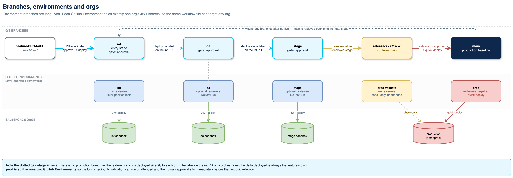

Environment branches are **long-lived**, never recreated. Feature branches are
short-lived and named for their tracker key.

```mermaid
flowchart LR
    F["feature/PROJ-###<br/><i>short-lived</i>"]
    I["<b>int</b><br/>entry · gate: approval"]
    Q["<b>qa</b><br/>gate: approval"]
    S["<b>stage</b><br/>gate: approval"]
    R["release/YYYY.WW<br/><i>cut from main</i>"]
    M["<b>main</b><br/>production baseline"]

    F -->|"PR + validate<br/>+ approve → deploy"| I
    I -.->|"deploy:qa label<br/>on the int PR"| Q
    Q -.->|"deploy:stage label<br/>on the int PR"| S
    S -->|"release-gather<br/>deployed:stage"| R
    R -->|"validate → reviewer<br/>→ quick-deploy"| M
    M -.->|"sync-env-branches<br/>after go-live"| I

    style M fill:#0D274D,stroke:#0D274D,color:#fff
    style I fill:#E6F7FD,stroke:#00BCEB,stroke-width:2px
    style Q fill:#E6F7FD,stroke:#00BCEB,stroke-width:2px
    style S fill:#E6F7FD,stroke:#00BCEB,stroke-width:2px
    style R fill:#fffbe6,stroke:#e6a100
    style F fill:#fff,stroke:#5B7186
```

### There is no promotion branch

Note the **dotted** qa/stage arrows. The feature branch is deployed *directly* to
each org. The label on the int PR only **orchestrates** — the delta deployed is
always the feature's own. This is why a change can be in `qa` without `qa` having
merged anything from `int`.

### Branch protection

Applied by `sf-pipeline/scripts/setup-branch-protection.sh` (idempotent, reads
the chain from the config; `DRY_RUN=true` prints the payloads). **Every pipeline
branch is pull-request-only** — a branch anyone with write access can push to
skips every deploy and guard:

| Branch | Protection |
|---|---|
| **entry** (`environments[0].branch`) | PR-only · `REQUIRED_REVIEWS` approvals (default 1) · code-owner review · required statuses `pr-validation` (approval-gated entry) and `deploy-<entry>` · stale reviews dismissed · conversation resolution |
| **later stages** (`qa`, `stage`, …) | PR-only with 0 approvals (the pipeline opens and merges these PRs unattended) · required status `deploy-<env>` |
| **production** (`production.branch`) | PR-only · the entry branch's approvals and code-owner review · no required status |
| all | no force-push · no deletion |

Why these, and not more:

- **Required statuses are commit statuses the pipeline writes**, keyed by
  environment *name*. `deploy-<env>` is written only by a real deploy, on the PR
  head, immediately before `merge-pr` squash-merges with the workflow token — so a
  PR into a stage can merge only once its exact commit is live there, and the merge
  button cannot get ahead of the pipeline. The jobs' own check runs are named
  `<caller job> / <job>` by GitHub, so they cannot be required by a fixed name.
  The production branch has no status to require: the release train deploys, then
  merges the release PR (`prod-release.yml`, finalize) without writing one.
- **Required statuses are pinned to the GitHub Actions app** (`STATUS_APP_ID`,
  default `15368` on github.com). The pipeline writes them with `GITHUB_TOKEN`, so
  a `deploy-<env>` someone posts with their own token can't satisfy protection.
  `STATUS_APP_ID=""` leaves them unpinned; on GitHub Enterprise Server pass your
  instance's GitHub Actions app id. The guards apply the same rule (§12).
- **Later stages need no human review**: the change was reviewed on entry, and the
  ordering guard requires `deploy-<env>` from every earlier stage before a
  promotion deploys.
- **The production branch carries the entry review rule** because both production
  GitHub Environments trust it (§5): whatever lands there, the caller workflows
  included, runs with production credentials. The release PR is merged by the
  workflow token, so with `REQUIRED_REVIEWS ≥ 1` it needs an Approve review —
  `prod-approved` alone satisfies preflight but not this rule.
- **Code-owner review** (`REQUIRE_CODE_OWNER_REVIEWS`, default: on when
  `REQUIRED_REVIEWS ≥ 1`, off at 0) makes a PR that edits a caller workflow or
  `pipeline.config.yml` wait for an owner named in `.github/CODEOWNERS` —
  `examples/consumer/.github/CODEOWNERS` is the template. It gates the **merge**:
  `pull_request` runs still execute the PR's own copy of the callers before anyone
  reviews it, with the sandbox environments' secrets (see §5).
- **The post-release realign keeps it.** `sync-branches` snapshots each env
  branch's protection, lifts it, pushes (`--force-with-lease`) and restores it with
  `PIPELINE_PAT` — app-pinned checks, review rules, *require last-push approval*,
  dismissal and bypass lists, lock, fork syncing and signed commits included. If
  GitHub rejects the full snapshot it restores the core rules and warns; if it
  can't restore at all, the step fails and prints the snapshot (§11).
  `tests/test_branch_protection.py` proves the round trip.

`enforce_admins` defaults to **false** so an admin keeps an escape hatch — GitHub
forbids approving your own PR — and so an admin `PIPELINE_PAT` can push the
**Sync Env Branches** merge onto a PR-only branch (without it, that workflow opens a
sync PR per branch). Set `ENFORCE_ADMINS=true` for a real multi-developer team. A
solo maintainer runs `REQUIRED_REVIEWS=0`, sets `allow_self_approval: true` (§6),
approves with the `approved` label and authorizes releases with `prod-approved`.
A `gate: auto` entry branch gets 0 required reviews whatever `REQUIRED_REVIEWS`
says (it is merged unattended after every deploy); it still requires its
`deploy-<entry>` status.

---

## 5. Environments, orgs and secrets

| Environment | Branch | GitHub Environment | Reviewers | Test level | How a change arrives |
|---|---|---|---|---|---|
| int | `int` | `int` | no | `RunSpecifiedTests` | PR approved → real deploy → merge |
| qa | `qa` | `qa` | optional | `RunSpecifiedTests` (default) or `NoTestRun` | `deploy:qa` label on the int PR |
| stage | `stage` | `stage` | optional | `RunSpecifiedTests` (default) or `NoTestRun` | `deploy:stage` label on the int PR |
| prod (validate) | `main` | `prod-validate` | **no** | `RunSpecifiedTests` | check-only, unattended |
| prod (deploy) | `main` | `prod` | **yes** | quick-deploy (full deploy when the validation ran no tests, §11) | reviewer-gated release train |

### Why credentials live in GitHub Environments

Each GitHub Environment holds exactly one org's JWT secrets:

| Secret | Meaning |
|---|---|
| `SF_CONSUMER_KEY` | Connected-app consumer key (client id) |
| `SF_USERNAME` | Integration user for that org |
| `SF_INSTANCE_URL` | Login / My Domain URL |
| `SF_JWT_KEY` | **base64-encoded** `server.key` |

Because `jobs.<id>.environment` accepts an expression, the *same* workflow file
can target any org — the environment name is resolved from config at run time and
GitHub injects that org's four secrets. Adding a sixth org is a config edit plus a
new GitHub Environment, not a code change.

### Why production is split across two environments

`prod-validate` has **no** reviewers; `prod` has required reviewers. If a single
environment carried both, the reviewer would be paged *before* the hours-long
validation began — asked to approve something nobody had tested yet. Splitting
them lets validation run unattended and pages a human only once the release is
provably deployable.

### Only the production branch can use the production secrets

Both environments hold the **production org's** JWT credentials — `prod-validate`
is check-only by convention, not by permission. A GitHub Environment with no
deployment branch rule gives its secrets to a job on *any* ref, so without one,
anyone with write access could push a branch whose workflow names `prod` and read
them. Project Init (`init-project.sh`) therefore sets both to **selected
branches: `production.branch`** — creating them that way, and tightening existing
ones while keeping their reviewers, wait timer and admin bypass.

That one branch is enough: GitHub matches the rule against the run's `GITHUB_REF`,
and every Prod Release job runs on the ref it was dispatched from — the production
branch. `release/*` is deliberately not allowed (any writer can push one), and
neither is anything a `pull_request` run uses (`refs/pull/<n>/merge`). One
consequence: a PR **into** a release branch, which `plan.py` would validate against
`prod-validate`, is refused at the environment; production is validated by the
release train itself.

**Prevent self-review.** With two or more required reviewers on `prod`, enable
*Prevent self-review* so whoever dispatches a release can't approve its deploy.
Leave it off for a solo maintainer, who would otherwise be unable to release.

### What a writer can reach

Branch rules can't protect the sandbox environments the same way: PR validation,
the approval deploy and label promotion run on `pull_request*` events, from the
PR's merge ref and with the PR's own copy of the caller workflows. A developer
with write access can therefore run code with a sandbox's credentials before any
review — give each sandbox integration user only what deployment needs. (CODEOWNERS
only blocks the *merge*; this is GitHub behaviour.) A deployment branch policy on
a sandbox environment would close it, but those runs' `refs/pull/<n>/merge` refs
can't match one, so add it only if you accept that PR validation, the approval
deploy and promotions can no longer use that environment. Likewise
every **repository** secret is readable by a workflow any writer pushes:
`PIPELINE_PAT` is in practice repo admin for every writer, so scope it to this
repository, and delete the Org Bootstrap secrets (§19) once onboarding is done.

### Optional repo-level secrets

`PIPELINE_PAT` (admin; PR creation where Actions may not open PRs, PRs that start
their own checks, the post-release realign and Sync Env Branches on protected
branches, Project Init creating environments),
`CHAT_API_TOKEN`, `CHAT_CHANNEL_ID`, `CHAT_WEBHOOK_URL`,
`SONAR_TOKEN`, `SONAR_HOST_URL`,
`JIRA_BASE_URL`, `JIRA_EMAIL`, `JIRA_API_TOKEN`.

---

## 6. Configuration reference

`sf-pipeline/pipeline.config.yml` in the **consumer** repo is the single edit
surface. It is read at run time by the `plan` composite action
(`sf-pipeline/scripts/plan.py`).

### Where the config is read from

A PR must not be able to relax the gates that judge it, so the `plan` action's
`config_ref` input fetches the file from a trusted branch instead of the
checked-out workspace, and reports which one in its `config_source` output:

| Run | Gates and environments come from |
|---|---|
| PR validation, approve-guard, the approval deploy (also via `manual_pr`) | The PR's **base** branch |
| Label promotion | The **control PR's** base branch (the entry branch) |
| Prod Release, the runbooks, Project Init, Sync Env Branches, a manual PR Validation | The dispatched ref's checkout (`config_source=workspace`) |

The base branch counts only if it is **protected** — anyone with write access can
create an unprotected branch — otherwise the repository's default branch is used.
So a PR's own change to `pipeline.config.yml` takes effect only after it merges.
Three keys describe the code being shipped rather than policy, and still come
from the change itself (`plan.py --code-config`): `source_path`, `api_version`
and `node_version`. Because a PR can set them, they are validated — plain
relative path / version characters only, or the run fails.
`node_version` takes what `actions/setup-node` accepts (`22`, `22.x`, `20.11.1`,
`lts/*`, `lts/iron`, `latest`); a leading `/` or `..` is refused, as for `source_path`.

### Top-level keys

| Key | Default | Meaning |
|---|---|---|
| `source_path` | `force-app` | Root of the sfdx-format metadata |
| `api_version` | — | Metadata API version used for the delta package |
| `node_version` | — | Node version for the CLI and LWC Jest |
| `baseline_branch` | `main` | The branch representing production; the release train merges here |
| `delta_baseline` | `prod` | Which ref the delta is computed against — see §13 |
| `org.prod_org` | — | Production My Domain base (before `--sandbox`) |
| `org.username_base` | — | Integration user; sandboxes append `.{sandbox}` |
| `environments[]` | — | The promotion chain, in order. First entry is the entry stage |
| `production.*` | — | Prod branch, the gated/ungated environments, targeting mode |
| `quality_gates.*` | all `true` | `pmd`, `sonar`, `apex_coverage` |
| `coverage_threshold` | `75` | Minimum aggregate Apex coverage % |
| `profiles_mode` | `full` | `full` or `incremental` — see §14 |
| `bypass_label` | — | Label an **admin** can add to bypass quality gates |
| `require_pr_approval` | `true` | Whether a reviewer approval is required at the entry stage |
| `allow_self_approval` | `false` | Whether a PR's author may approve its own **entry** deploy with the `approved` label (§9). A solo operator sets `true` on the entry branch — an admin can commit it there directly |
| `notifications.chat` / `.jira` | — | Toggle each integration |

### Per-environment keys

| Key | Meaning |
|---|---|
| `name` | Logical stage name used in logs and labels |
| `branch` | The git branch mapped to this org |
| `gh_environment` | The GitHub Environment holding this org's secrets |
| `sandbox` | The **real** sandbox name (defaults to `name`) |
| `gate` | `auto` · `approval` · `on_demand` |
| `test_level` | `RunSpecifiedTests` · `RunLocalTests` · `NoTestRun` · … |

### Gate semantics

| Gate | Behaviour |
|---|---|
| `auto` | Every push to a non-draft PR into the branch (opened · reopened · synchronize · ready for review) → real deploy → merge at the deployed SHA, no approval. No PR Validation run, so the deploy guard skips the `pr-validation` check; with Apex and the coverage gate on, the deploy validates with the tests first (`gated`, §15). A push during a run makes it stop — the run for the newer commit deploys it |
| `approval` | PR → check-only validation + report; approval (or the `approved` label) triggers the real deploy + merge. A push to the PR deploys nothing |
| `on_demand` | Not PR-driven; deployed via the promotion label or a manual runbook |

> **`gate: auto` needs the current deploy caller.** The example
> `examples/consumer/.github/workflows/deploy.yml` also fires on `pull_request`
> `opened`, `reopened`, `synchronize` and `ready_for_review`; a caller copied
> before that listens only for reviews and labels, and never deploys an auto
> stage. Copy the example again. As the entry stage, an auto branch also needs
> `REQUIRED_REVIEWS=0` in branch protection (§4).

**Gate defaults (`plan.py` → `normalize_envs`).** When `gate:` is omitted:

- `environments[0]` falls back to `require_pr_approval` — `approval` if true, `auto` if false.
- Every later environment defaults to `on_demand`.
- An unrecognised value coerces to `on_demand`.

### Production targeting — three modes

| Mode | Keys | Resolves to |
|---|---|---|
| **A — sandbox as prod** (training / lower envs) | `is_sandbox: true` + `sandbox: <name>` | `https://{prod_org}--{sandbox}.sandbox.my.salesforce.com`, user `{username_base}.{sandbox}` |
| **B — real production org** | `is_sandbox: false` | `https://{prod_org}.my.salesforce.com`, user `{username_base}` |
| **C — explicit override** | `instance_url:` + `integration_username:` | Exactly what you specify |

Other production keys: `release_branch_prefix` (default `release/`), `test_level`,
`destructive_tests` (the canary — see §11), and `release_label`.

**`release_label`** is the label the release train gathers PRs by. It defaults to
`deployed:<last environment's name>`, so a project that renames its final
pre-production stage needs no change — the train follows the config. Set it
explicitly only if you stamp a label the pipeline did not generate.

### The `plan` action's three modes

| Mode | Input | Key outputs |
|---|---|---|
| `outputs` | — | The whole resolved config, including `eff_baseline`, `last_env` and `release_label` |
| `resolve` | a **branch** | branch → env; `r_is_stage` is true **only** for `auto` / `approval` gates |
| `promote` | an **env name** | Guard rails for a manual promotion; refuses PR-driven stages |
| `prdeploy` | an **env name** | `r_require_env` (the immediately preceding env, **regardless of its gate**), `r_require_envs` (every earlier env, in order — what the ordering guard checks), `r_is_entry`, `r_branch`, `r_next_*` |

> **`resolve` is keyed by branch; `promote` and `prdeploy` are keyed by name.**
> Passing an environment *name* to `resolve` silently returns nothing whenever
> `name != branch`, because `resolve` deliberately treats an unmapped branch as
> inert rather than an error. This distinction is covered by
> `tests/test_config_matrix.py`.

### Reference configuration

The maintained example is
[`sf-pipeline/pipeline.config.example.yml`](../sf-pipeline/pipeline.config.example.yml).
The live reference consumer is `sfdx-pipeline-example`, which sets (org URLs and
integration users left out):

```yaml
delta_baseline: prod            # every stage diffs against main
baseline_branch: main
environments:
  - { name: int,   branch: int,   gh_environment: int,   gate: approval, test_level: RunSpecifiedTests }
  - { name: qa,    branch: qa,    gh_environment: qa,    gate: on_demand }   # test_level defaults to RunSpecifiedTests
  - { name: stage, branch: stage, gh_environment: stage, gate: on_demand }
production:
  branch: main
  deploy_environment: prod      # required reviewers
  validate_environment: prod-validate
  release_branch_prefix: "release/"
  test_level: RunSpecifiedTests
  destructive_tests: ""         # no canary: a no-Apex release is deployed in full after approval
quality_gates: { apex_coverage: true }
coverage_threshold: 85
profiles_mode: full
allow_self_approval: true       # solo operator
```

With no `test_level` on qa and stage, their promotions run `RunSpecifiedTests` and
an Apex promotion goes through the coverage gate (`gated`), not `NoTestRun`.

---

## 7. End-to-end flow

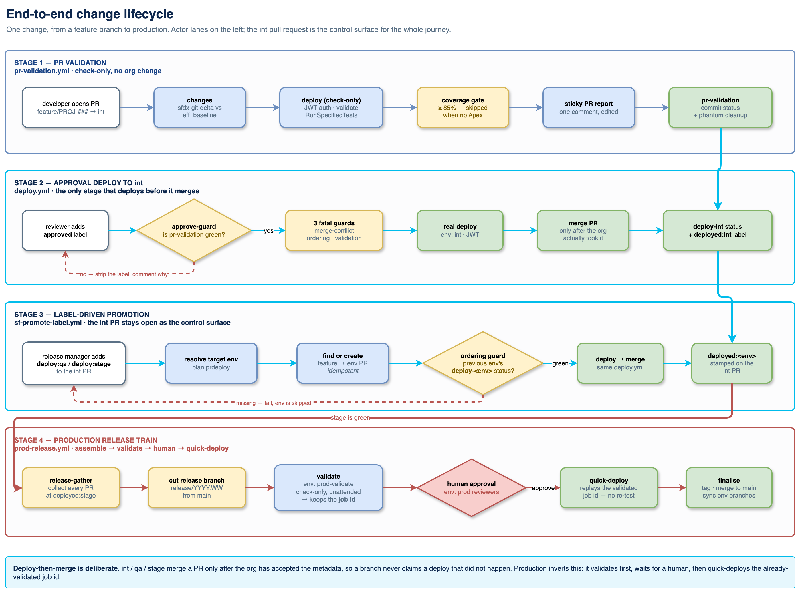

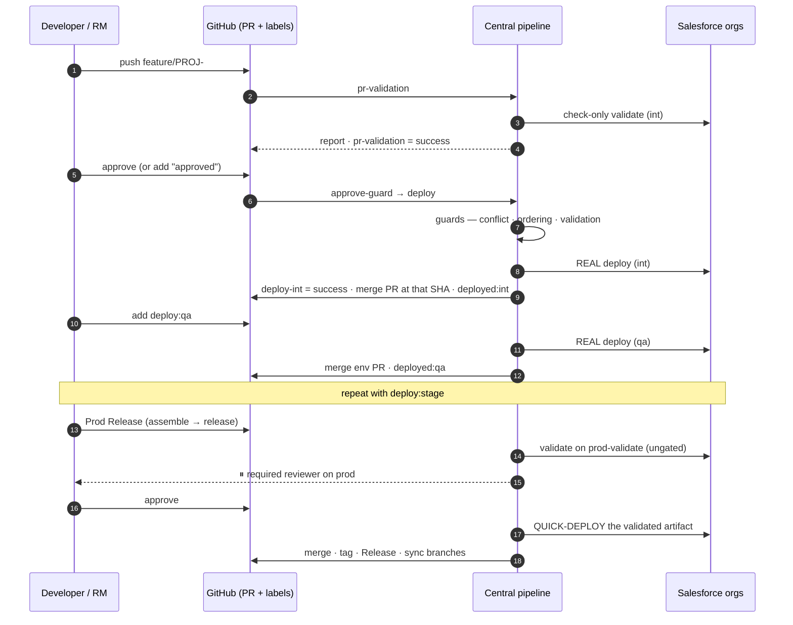

---

## 8. Stage 1 — PR validation

Runs on PR open/update into the entry branch. **Never deploys for real, never
merges.**

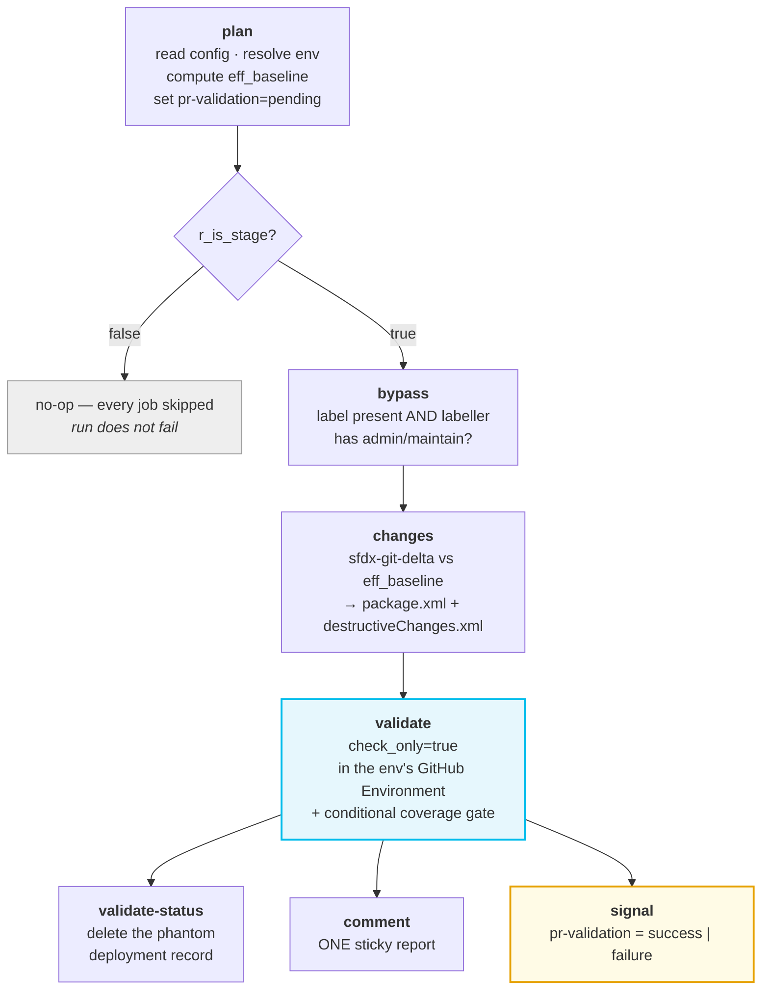

Four details that matter:

- **A change without Apex is validated too.** `sf project deploy validate` won't
  take `NoTestRun`, so a config-only delta runs a check-only
  `sf project deploy start --dry-run`: every component is still checked against
  the org, and the validation can fail. (It used to be skipped, so it was always
  green.)
- **`eff_baseline`** — with `delta_baseline: target` the delta is computed against
  the PR's base branch, so the report describes *exactly* what the approval deploy
  will push. With `prod` every env diffs against `baseline_branch`.
- **Phantom-proofing** — a check-only run against a GitHub Environment creates a
  deployment record. `validate-status` marks it inactive and deletes it so it can
  never satisfy a downstream ordering guard. This is load-bearing, not cosmetic.
- **`pr-validation` commit status** is the durable output. Both the approval guard
  and the entry-stage deploy guard key off it — not off job results, and only off
  the status the pipeline wrote (§12).

---

## 9. Stage 2 — approval deploy (deploy-then-merge)

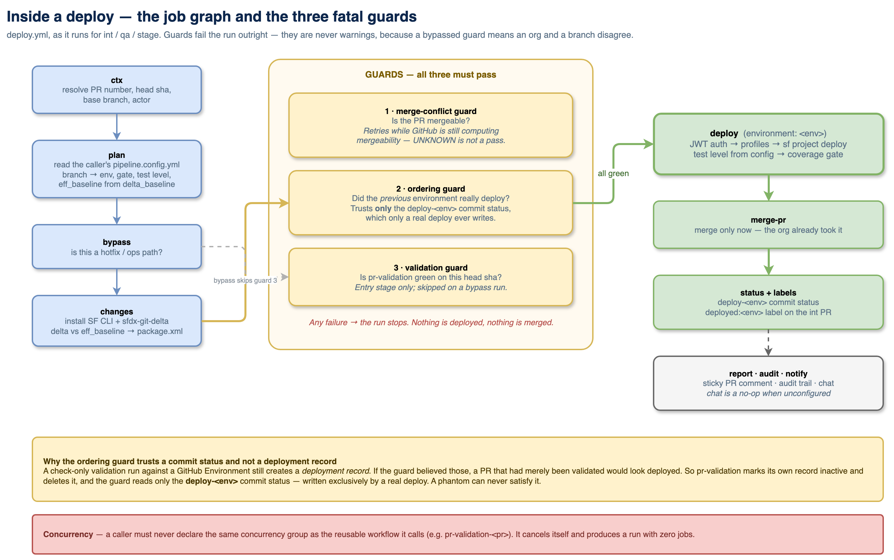

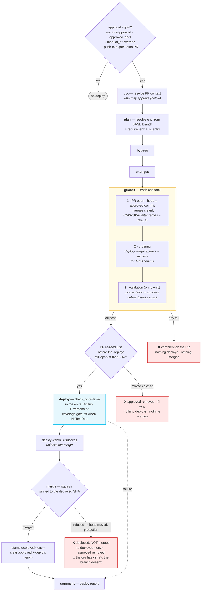

**The invariant:** the PR merges *only* after the org deploy succeeds, so an
environment branch never advances ahead of a real deployment.

### Exactly the approved commit is deployed and merged

An approval is for one commit, the PR head when it was given. Right before the
deploy the PR is read again: if a commit was pushed after the approval, or the PR
was closed, nothing deploys, `approved` is removed and the PR says why (*Not
deployed to `<env>` — a new commit was pushed after … was approved*). The merge
is pinned to the deployed SHA (`gh pr merge --match-head-commit`), so a commit
pushed **during** the deploy is never merged undeployed: the PR stays open,
`deployed:<env>` is not stamped, `approved` is removed and the comment says the
org has `<sha>` but the branch does not. The deploy report is not posted then —
it would claim "deployed and merged". Either way, approve again once PR
Validation is green for the new head; the pipeline deploys and merges exactly
that commit. On a `gate: auto` stage the newer push has already started its own
run, which deploys it.

### The three fatal guards

| # | Guard | Question | Notes |
|---|---|---|---|
| 1 | PR state + merge conflict | Is the PR **open**, is its head still the commit being deployed, and does it merge cleanly? | Retries while GitHub computes mergeability — `UNKNOWN` after the retries is a refusal, not a pass |
| 2 | ordering | Did **every earlier** environment really deploy **this commit**? (`stage` checks `int` and `qa`) | Trusts **only** the `deploy-<env>` commit status, and only one created by `github-actions[bot]` |
| 3 | validation | Is `pr-validation` green for this head SHA? | Entry stage only (and not an auto stage); skipped when a bypass is active. Same creator rule |

Guard 2 is why phantom deletion matters: a check-only run must never be mistakable
for a deploy.

### Who may approve

The approval action checks the person behind the signal, using the config from
the PR's base branch:

| Signal | Accepted from |
|---|---|
| **Approve** review | Someone with write access to the repo (on a public repo anyone can submit an Approve review; it starts nothing) |
| `approved` label, entry stage | A repo **admin** — and not the PR's own author, unless `allow_self_approval: true` |
| `approved` label, later approval-gated stage | Anyone with write access (a developer self-approves; the ordering guard is that stage's gate) |
| `manual_pr` dispatch | admin or maintain; waives the peer approval |

A refused label is removed with a comment saying why. The label is matched
case-insensitively, so `Approved` works too.

### Approval guard

GitHub forbids approving your own PR, so on qa/stage a developer self-approves
with the `approved` label. Labels have no native preconditions — `approve-guard`
supplies one. It reads the gates from the PR's base branch, re-verifies who
added a bypass label (the label alone is not authority), and trusts only a
`pr-validation` status the pipeline wrote.

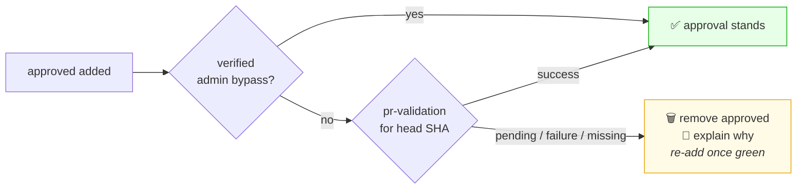

---

## 10. Stage 3 — label-driven promotion

The **int PR is the control surface** once it has been approved, deployed and
**merged** — a promotion only ever ships the commit the entry stage deployed.

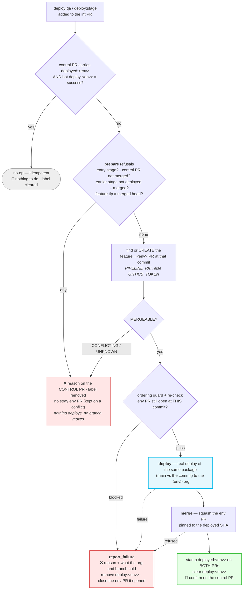

### When `prepare` refuses

Each refusal is explained on the **control PR**, removes `deploy:<env>` (so
re-adding it retries), deploys nothing and moves no branch. Most are checked
before any env PR exists, and one this run opened is closed again — except on a
conflict, where it stays open to show the conflicting files:

| Refused when | Why |
|---|---|
| The label names the entry stage | `deploy:<entry>` is not a promotion — the entry stage deploys on approval |
| The control PR isn't merged | A promotion ships what the entry stage approved, deployed **and** merged |
| An earlier stage lacks `deploy-<env>` = success (written by `github-actions[bot]`) for the commit, or the control PR lacks `deployed:<env>` | Not deployed there yet — or deployed but not merged (its promotion is still running, or its merge was refused) |
| The feature branch tip isn't the control PR's merged head | Commits pushed after the int merge were never deployed anywhere: open a new PR from the branch into int and promote from that, or reset the branch to the merged head |
| The env PR conflicts, or GitHub hasn't computed its mergeability | A PR that can't merge would only fail **after** the deploy |

**Resolving a conflict.** A promotion merges only the commit int deployed, so a
fix pushed to the feature branch is a new commit: take it through int first (a
new PR into int), then promote from that PR.

Key properties:

- **Exactly the deployed commit merges.** The env PR's head must be the commit
  being promoted — `prepare` checks it, the deploy job re-checks it right before
  the org is touched, and the merge is pinned to the deployed SHA
  (`--match-head-commit`).
- **Idempotent** — a label re-added after `deployed:<env>` is a no-op, but only
  when the bot-written `deploy-<env>` status is there too: a hand-added
  `deployed:<env>` is not trusted, and the promotion runs.
- **Self-healing on failure** — every failure comment names the reason
  (Salesforce errors inline) and says what the org and the branch hold, removes
  `deploy:<env>` so it can simply be re-added, and closes the env PR if this run
  opened it. An unknown `deploy:<x>` label gets a comment and is removed;
  `deploy: qa` (with a space) is rejected.
- **`deployed:stage`** is where the release train starts looking — it then checks
  the commit statuses (§11).

---

## 11. Stage 4 — production release train

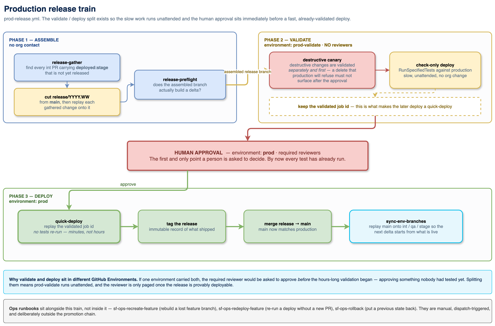

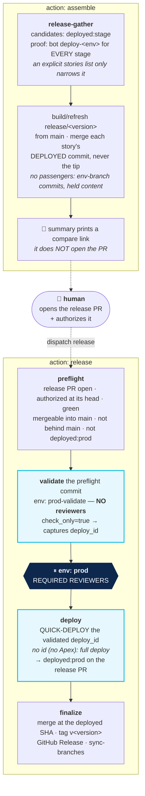

> [!NOTE]
> **`assemble` deliberately stops short of opening the release PR.** It pushes the
> release branch and prints a pre-filled compare link. A human opens the PR, which
> forces someone to read the production change set. `preflight` then refuses to
> proceed unless that PR is **authorized** — approved by a *different* user, or
> carrying the **`prod-approved`** label. Since GitHub forbids self-approval, a
> solo operator must use the label.

**Validate-then-quick-deploy is the point.** Production is not recompiled or
re-tested after approval — the exact artifact validated against `prod-validate` is
the one promoted. *What a reviewer approves is what ships.* (A release without
Apex is the one exception — see [No-Apex releases](#no-apex-releases).)

### What may be released

`release-gather` uses `deployed:<last env>` only to **find** candidates. A story
ships only when its deployed commit carries `deploy-<env>` = success, created by
`github-actions[bot]`, for **every** stage (`deploy-int`, `deploy-qa`,
`deploy-stage`). A hand-added label or a status someone posted is ignored with a
warning — otherwise a story deployed to int only could reach a release.

- **Assemble merges that exact commit**, never the branch tip. Commits pushed to
  the story branch afterwards never went through the stages; they are left out
  with a warning. The job summary lists each story with the commit released.
- **An explicit `stories` list only narrows the gather.** A named story that isn't
  proven, is on `hold` or has no merged PR fails the run.
- **Nothing unaccounted for.** Assemble refuses a release branch holding commits
  that no proven story accounts for (a story since put on hold, a hand push):
  assemble a new version, or delete the branch and re-run.
- **Only the stories' own work.** A deployed commit can carry other stories as
  its ancestors: a story branch that merged an env branch (`git merge origin/int`
  to settle a conflict) holds every story squashed into int, held or never
  selected, and one that merged another story's branch holds that story.
  Assemble refuses a gathered commit that contains commits of an env branch which
  `main` doesn't have, and refuses the release when any file a story on `hold`
  changed carries that story's version (unless `main` already has it), however it
  got there. Settle a conflict by rebasing the story on `main`, never by merging an
  env branch into it.
- **Nothing to release is an error**, not an empty release.

### One commit, end to end

Preflight records the release PR's head commit, and that commit is what is
validated, deployed and merged (`gh pr merge --match-head-commit`): a push to the
release branch meanwhile can't slip into production or into `main`.

An authorization is for the content it saw. Re-assembling an open release PR with
new content removes `prod-approved` (and says so on the PR), and an Approve review
counts only for the commit it approved. Preflight also refuses — before anything
is deployed — when branch protection would block the release PR's merge into
`main` (`mergeStateStatus` `BLOCKED`, e.g. a required review is missing and only
the label was given) or when it conflicts.

**Never behind `main`.** The release branch is cut from `main`. Anything merged
into `main` after assemble (a hotfix, a rollback) is not in the release, and
deploying the release would undo it in production. Preflight therefore refuses a
release PR that is behind `main` — it asks the compare API, since GitHub reports
`BEHIND` only when protection requires up-to-date branches — and the deploy job
checks again after the reviewer's approval, which can come hours later. Run
**assemble** for the same version again: it merges `main` in and removes
`prod-approved`, so authorize the new content. The production delta is
computed three-dot as well, like every other stage — against the merge-base of
`main` and the release, i.e. what assemble started from — so a component only
`main` has is never turned into a deletion.

### No double deploy

Right after the production deploy the release PR gets
`deployed:<deploy_environment>` (e.g. `deployed:prod`), and preflight refuses a PR
that carries it. If finalize failed, **re-run the failed finalize job** — it skips
a PR that is already merged — instead of running the release again.

### No-Apex releases

A release whose delta has no Apex is still validated against production before the
reviewer is asked: a check-only `sf project deploy start --dry-run` that runs no
tests. Salesforce quick-deploys only a validation that ran tests, so after
approval the deploy job deploys the same delta again — a full, atomic deploy —
unless `destructive_tests` names a canary: the validation then runs it, and the
release quick-deploys what was validated. In production `--test-level` is omitted
for a package without Apex (Salesforce runs no tests for it; `NoTestRun` is only
for development orgs). The run summary and the chat message say which case
applied, and the deploy job uses the same `test_level`, destructive tests and
`profiles_mode` as the validation.

**Destructive canary.** Salesforce forbids `NoTestRun` whenever Apex is involved,
including deletions. A destructive-only production change therefore runs the
configured `destructive_tests` canary rather than a whole, possibly red, org
suite. A deletion has no coverage requirement, so a single stable passing test
satisfies the platform. Blank falls back to `RunLocalTests`.

### Quick deploy refused

If Salesforce refuses the quick deploy — the validation is older than 10 days, was
already used, or production changed under it — the release stops before the
merge and the tag with an explicit error. Check **Setup → Deployment Status** in
production, then run the release again: it validates again and asks for approval
again. There is **no automatic fallback**, by design: a client timeout looks the
same while the org keeps deploying, and a second deploy on top would not be the
artifact the reviewer approved. If the deploy did complete after all, don't deploy
again — the job summary gives the manual finish (label, merge, tag, sync).

### Post-go-live sync

`sync-branches` realigns every env branch with `main` so the next delta starts
from what is live:

| The env branch… | Result |
|---|---|
| holds nothing that isn't in `main` | reset to `main` |
| holds unreleased stories (deployed there, not released yet) | `main` is merged into it |
| holds changes that conflict with `main` | left as is, with a warning — resolve it with **Sync Env Branches**, which opens a conflict PR cut from the production branch |

Pushes use `--force-with-lease`, so a branch that moved meanwhile is never
overwritten. Protection is lifted for the push and restored with `PIPELINE_PAT`,
app-pinned checks and the extra settings included (§4). If it can't be restored,
the step fails and prints the snapshot; the release itself is done by then.

---

## 12. Label and commit-status state machine

The pipeline carries **no database**. Labels and commit statuses *are* the state.

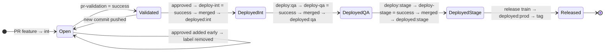

**Deployed is not merged.** `deploy-<env>` is written right after the deploy and
unlocks the merge; `deployed:<env>` is stamped only **after** the merge. A commit
with `deploy-<env>` but no `deployed:<env>` was deployed but not merged (the
merge was refused, or the promotion is still running), and later stages refuse
it until it is merged.

**Only the pipeline's statuses count.** The pipeline writes every commit status
with `GITHUB_TOKEN`, so they are created by `github-actions[bot]`. The guards,
the promotion workflow, approve-guard and `release-gather` read only those; a
`deploy-<env>` or `pr-validation` someone posts with their own token or a PAT is
ignored, and branch protection pins the same contexts to the GitHub Actions app
(§4).

### Markers

| Marker | Kind | Written by | Read by |
|---|---|---|---|
| `pr-validation` | commit status | pr-validation `signal` | approve-guard · entry deploy guard · branch protection |
| `deploy-<env>` | commit status | **real deploy only** | ordering guard · promotion `prepare` · `release-gather` · branch protection — creator `github-actions[bot]` only |
| `approved` | label | human (§9: who may) | deploy trigger · approve-guard |
| `deploy:<env>` | label | human | promotion trigger |
| `deployed:<env>` | label | pipeline, after the merge | promotion idempotency (with `deploy-<env>`) · `release-gather`'s index of candidates — not proof of a deploy |
| `bypass-quality-gates` | label | **admin only** | bypass action (permission re-verified at run time; dropped by a later push) |
| `prod-approved` | label | human, on the **release PR** | `release-preflight` — authorizes the production release |
| `deployed:<deploy_environment>` | label | release train, on the **release PR** | `release-preflight` — refuses a second deploy of the same release |

Because the state lives on the PR, the int PR remains meaningful after merge — it
is the object the promotion labels are applied to and the object `release-gather`
queries.

---

## 13. Delta computation and baselines

Deltas are computed with **sfdx-git-delta** by the `changes` composite action,
producing a `package.xml` and, where relevant, a `destructiveChanges.xml`.

### `delta_baseline` — the two modes

| Mode | Behaviour | When to use |
|---|---|---|
| `target` | Each deploy/validation diffs against the PR's **target env branch** (int PR → `origin/int`, qa PR → `origin/qa`). The package is exactly what that environment is missing, so a QA package can legitimately differ from the INT package for the same story. | Environments can drift — e.g. hotfixes land straight into a higher env |
| `prod` *(default)* | Every environment diffs against `baseline_branch`. Every stage validates and deploys the identical prod-relative artifact. | Environments are kept in lockstep |

The resolved value surfaces as **`eff_baseline`** and is computed in
`deploy.yml`, `pr-validation.yml` and `sf-promote-label.yml`, so a promotion
deploys the same package as the entry deploy. The reference consumer `sfdx-pipeline-example`
uses `prod`.

**Every delta is three-dot** (`delta_merge_base: true`): PR validation, the entry
deploy, promotions and both production jobs diff against the merge-base of the
baseline and the branch, so a baseline that moved on after the branch was cut
never turns its own new components into deletions.

**A delta that can't be computed fails the run.** A deploy treats "no changes" as
success and merges, so `delta.sh` fails instead of reporting no changes when
sfdx-git-delta fails, when it writes no `package.xml`, or when the merge-base
(three-dot mode) can't be computed — a two-dot diff against a drifted branch
would turn everything only the other side has into deletions. It also outputs
`from_ref`, the ref the delta really came from, which the dependency lint and
incremental profiles (§14) diff against.

### Deletions the org no longer has

Salesforce fails the **whole** deploy on a deletion of a component the target org
doesn't have (*No `<Type>` named: … found*) — orgs drift, and a component may
never have reached that org. Before deploying, `prune_destructive.py` lists each
deleted type in the target org (`sf org list metadata`) and drops the deletions
it has positively confirmed absent. It keeps a deletion whenever it is unsure:
types whose listing fails, folder-based types (Report, Dashboard, Document,
EmailTemplate), `StandardValueSet` and `Settings`; names are compared URL-decoded
and case-insensitively. Skipped deletions appear in the job summary, the PR
report and `skipped-deletions.json` in the `deploy-report-<env>` artifact. If
nothing is left to deploy, the deploy succeeds without deploying anything (mode
`nothing-left`). A quick deploy promotes an already validated package, so nothing
is pruned there.

### Test selection

`sf-pipeline/scripts/specified_tests.py` resolves which Apex tests to run for
`RunSpecifiedTests`, so a delta that touches no Apex does not drag the whole org
suite into the run. `NoTestRun` on qa/stage is safe precisely because int already
validated with tests.

Test names come from the Apex file names in the change. A changed class or trigger
whose name is not an Apex identifier (letters, digits and underscores, starting with
a letter) fails the validation before anything else runs, and the PR report says
which. Test names — like every other value — reach the deploy script through the
environment, never pasted into it, and so does the production canary
(`destructive_tests`), which must likewise be Apex class names, separated by commas.

---

## 14. Profiles and permission sets

Controlled by `profiles_mode`, applied automatically by the `deploy` action via
`sf-pipeline/scripts/profiles.py`, which prints a "Profiles / Permission Sets"
block into the job summary.

| Mode | Behaviour | Trade-off |
|---|---|---|
| `full` *(default)* | Deploy the complete Profile / Permission Set from source | Safest when every referenced component already exists in the target org |
| `incremental` | Each Profile / Permission Set in the delta is compared with the ref the delta came from (`from_ref` — for PR validation, PR deploys and promotions the merge-base of the baseline and the branch) and keeps only the permission entries that were **added or changed** there; profile-level settings are kept only when they changed. A file that is new on the branch deploys in full. Comparing with the baseline's *tip* instead would treat an entry another change updated there as this branch's change and deploy it back to the older value | Deploys exactly what the branch changed; avoids "component does not exist" failures on orgs that lag behind |

Profiles and permission sets are found anywhere under `source_path` (not only
`main/default`).

The *Redeploy Feature Branch* runbook exposes a `profiles_mode` override for
one-off runs.

---

## 15. Quality gates and coverage

Three gates, each firing **only when the delta actually contains the relevant
components**, so unrelated PRs are not slowed down:

| Gate | Fires when | Enforced |
|---|---|---|
| `pmd` | `*.cls` / `*.trigger` change | Apex static analysis |
| `sonar` | Apex **or** LWC/Aura JS change | SonarQube scan (needs `SONAR_TOKEN`, `SONAR_HOST_URL`) |
| `apex_coverage` | `*.cls` / `*.trigger` change | On a validation with the tests, against `coverage_threshold`, before anything is deployed |

The coverage gate is implemented in `sf-pipeline/coverage/coverage-gate.py` and is
**skipped when the env's `test_level` is `NoTestRun`** — there is no coverage to
assess. A PR containing only metadata such as custom fields correctly skips it
entirely. When Salesforce itself rejects a deploy, the coverage it measured is
still recorded and shown in the report. The report's coverage cell reads the
percentage against the threshold, *Bypassed*, *Rejected by Salesforce*, *Not run
(NoTestRun)*, *Not measured*, or *Not run (no Apex)* — the last only when the
delta really has no Apex.

### Bypass

An admin can add `bypass_label` to skip the gates. The bypass is honoured **only
if the person who added the label has admin/maintain permission on the repo**,
re-verified at run time by the `bypass` action — the label alone is not authority.
An active bypass also causes the entry-stage validation guard to be skipped. The
bypass is read from the PR being deployed, so it applies to the entry deploy only:
promotions open their own env PRs and always run the gate. A bypass covers the
commits the admin saw: commits pushed after the label was added drop it (PR
Validation removes it, like a stale review), and an admin re-adds it for the new
head. approve-guard re-verifies who added the label too.

### Where the gate sits

In PR validation the gate judges the check-only validation. In a **real** deploy
with Apex and the gate on — the approval deploy, an auto deploy, every promotion,
and *Redeploy Feature Branch* with `dry_run=false` — the deploy action runs in
`gated` mode: it validates the package with its tests first, the gate judges that
result, and only then quick-deploys the validated job. A change between
Salesforce's 75% and `coverage_threshold` therefore never reaches the org: the job
fails, nothing is deployed, and the env PR stays unmerged. A change without Apex,
a bypass and a `NoTestRun` stage deploy directly, without the gate.

A gated deploy makes two Salesforce jobs (validate, then quick deploy). If another
deploy lands in that org in between, Salesforce may refuse the quick deploy: the
run fails explicitly, nothing is deployed, and a retry validates afresh.

---

## 16. Audit trail

Every deploy / validate / promote / rollback records a structured entry via
`sf-pipeline/scripts/audit.py`:

1. A **🧾 Audit** table in the job summary — who, status, commit, components,
   profiles mode, coverage, deploy id, run link. For a quick deploy (the release,
   or a `gated` deploy) the deploy id is the quick deploy's own job; the
   validation it promoted is recorded as `validation_id`.
2. An `audit-record.json` uploaded with the `deploy-report-<env>` artifact.
3. For **real deploys only** (not check-only validations), one JSON line appended
   to the durable **`audit-log`** branch at `audit/audit-log.jsonl` — a permanent,
   greppable history. The append is best-effort and race-safe, so it can never
   fail a deploy.

Each record's `sha` / `short_sha` is the commit that was deployed (for a PR
deploy the same commit as `ref`). Records written before 2026-10-28 carry a
pull_request run's temporary merge commit in `sha`; look those up by `ref`.

```bash
git show audit-log:audit/audit-log.jsonl | jq 'select(.environment=="prod")'
```

---

## 17. Notifications

| Integration | Config | Secrets | Behaviour |
|---|---|---|---|
| **chat** | `notifications.chat` | `CHAT_API_TOKEN` + `CHAT_CHANNEL_ID`, or `CHAT_WEBHOOK_URL` | Posts deploy outcomes. **No-op when unconfigured** — never fails a run |
| **Jira** | `notifications.jira` | `JIRA_BASE_URL`, `JIRA_EMAIL`, `JIRA_API_TOKEN` | Links the story by the issue key in the branch name (e.g. `feature/PROJ-123-foo`); each deploy comments and transitions the story to that env's status |

Both are deliberately best-effort: a notification outage must not block a
deployment.

---

## 18. Ops runbooks

Four `workflow_dispatch` runbooks, all reusing the same config and composite
actions. They sit **alongside** the promotion chain, not inside it.

| Runbook | Purpose | Key inputs |
|---|---|---|
| **Recreate Feature Branch** | Cut a clean `feature/<name>` from the baseline when a branch is stale or corrupted | `name` (normalised to `feature/<name>`; path parts git refuses are dropped, never resolved, so `a/../b` becomes `a/b`), `base` (defaults to the pipeline baseline), `confirm_reset` (**required `true`** to reset an existing branch — destructive; the run summary records the previous tip) |
| **Redeploy Feature Branch** | Idempotently (re)deploy a feature branch's delta to any environment, to retry a flaky deploy or re-validate after an org change. Does **not** move any env branch | `feature_ref`, `environment`, `dry_run` (**default true** = check-only), `profiles_mode` (`config` = use `pipeline.config.yml`, the default · `full` · `incremental`; anything else is refused). Gates and environments come from the dispatch branch only if it is protected, else from the default branch |
| **Rollback** | Revert a deployed change and open a **revert PR** into the entry branch, so the rollback flows through the same gate → approve → deploy → merge path — fully validated, reviewed and audited. Nothing is force-deployed. The revert is cut from the production baseline whenever it applies there, so the PR carries only the revert and can be promoted like any story; a change that never reached production is reverted on `base`, and that PR **also carries every change on `base` that production doesn't have** (it says so — don't promote it). Renames are not followed (`-X no-renames`) | `pr_number` of a **merged** PR (an unmerged one is refused; merge commits use `-m 1` automatically) **or** `ref` (a commit SHA, 7–40 hex characters); `base` |
| **Sync env branches** | Merge `main` into every env branch; a conflict opens a PR cut from the production branch | dispatch it when branches drift, or when the post-release realign (§11) left a branch with conflicts |

A conflicting revert stops with manual `git revert` instructions rather than
guessing.

### Merging back to source sandboxes

Deployments flow **forward** through orgs, so developer sandboxes drift behind the
baseline. After a release, either refresh the sandbox from the promotion source
org in Salesforce Setup (cleanest for full parity), or cut a branch from the
baseline with *Recreate Feature Branch* and deploy it into the sandbox with
*Redeploy Feature Branch* (`dry_run=false`). Always start the next story's branch
from the baseline so its delta stays clean.

---

## 19. Org bootstrap and onboarding

`org-bootstrap.yml` plus the `sf-setup/` kit in the central repo automate standing
up a new org's connection: the `SF CICD Deploy` app, the JWT certificate, the
integration user, and writing the four secrets into the consuming repo's GitHub
Environment. Orgs that refuse new Connected Apps (the default since Spring '26)
get the same app as an **External Client App** (`sf-setup/metadata-eca/`); JWT
login and the four secrets are the same either way.

| Route | Runs | Needs |
|---|---|---|
| `sf-setup/scripts/bootstrap-org.sh` (one org) or `bootstrap-from-config.sh` (every org in the config) | Locally, from the consuming repo's root | `sf`, `gh` with repo admin, a one-time browser login per org |
| **Org Bootstrap** workflow | In Actions, one dispatch per org | Repository secrets `SFDX_AUTH_URL` (an admin of *that* org) and `BOOTSTRAP_TOKEN` (repo admin) |

The workflow is reusable, so it runs in the **consumer's** workspace, where
`sf-setup/` does not exist. It checks the kit out of the central repo at the ref
the caller pinned: its own `owner/repo/.github/workflows/org-bootstrap.yml@<ref>`
string is an internal reference that `cut-release.sh` rewrites like every `uses:`,
so `@v1` runs the v1 kit. Both its secrets are readable by any workflow a writer
pushes — delete them after the last org.

`push-env-secrets.sh` creates a missing environment but never re-`PUT`s an
existing one, so re-bootstrapping `prod` can't disturb its reviewers or its
branch rule (§5).

Step-by-step onboarding instructions live in
**[Pipeline_User_Guide.md](./Pipeline_User_Guide.md)**.

---

## 20. Workflow and action catalogue

### Reusable workflows — `.github/workflows/` (all `on: workflow_call`)

| Workflow | Purpose |
|---|---|
| `pr-validation.yml` | Check-only validation + quality gates + sticky report + `pr-validation` status |
| `deploy.yml` | The real deploy, guards, merge (pinned to the deployed SHA), status and label stamping. Serves every PR-driven stage: on approval, and on every push for a `gate: auto` stage |
| `approve-guard.yml` | Holds the `approved` label until validation is green (gates from the PR's base branch) |
| `sf-promote-label.yml` | Label-driven promotion orchestration |
| `prod-release.yml` | `assemble` and `release` — the production train |
| `sync-env-branches.yml` | Merge `main` into the env branches; a conflict opens a PR cut from the production branch |
| `org-bootstrap.yml` | Stand up a new org's connection and secrets |
| `project-init.yml` | Create the branches, labels and GitHub Environments a config declares |
| `sf-ops-recreate-feature.yml` | Recreate runbook |
| `sf-ops-redeploy-feature.yml` | Redeploy runbook |
| `sf-ops-rollback.yml` | Rollback runbook |

> **No workflow in this repository triggers on `push` or `pull_request`.** All
> eleven are `workflow_call` only, so the central repo cannot self-trigger a
> deploy. (`ci.yml` is this repository's own static-check build and is not part
> of the consumer surface.)

### Composite actions — `sf-pipeline/<name>/action.yml`

| Action | Purpose |
|---|---|
| `plan` | Read the caller's config → outputs (`outputs` / `resolve` / `promote` / `prdeploy` modes); `config_ref` reads the gates from a protected base branch (§6) |
| `init` | Create the branches, labels and GitHub Environments the config declares |
| `changes` | Install SF CLI + sfdx-git-delta; compute the delta and manifest |
| `deploy` | auth → delta → lint → skip absent deletions → profiles → validate/deploy (`gated`: validate → coverage gate → quick deploy) → report → audit |
| `guard` | The three fatal pre-deploy guards (PR open at the deployed commit + mergeable · ordering · validation) |
| `approval` | Interpret the approval signal and check who gave it (§9) |
| `bypass` | Resolve and **re-verify** an admin bypass |
| `merge-pr` | Squash-merge after a successful deploy, only at the deployed SHA (`--match-head-commit`); fails with a `reason` otherwise |
| `report` | The unified sticky PR comment |
| `status` | Write `pr-validation` / `deploy-<env>` commit statuses |
| `coverage` | Apex coverage gate |
| `release-gather` | Collect the stories for a release — candidates by `release_label`, proven by the bot's `deploy-<env>` statuses for every stage — and the exact commit of each, plus the branches on `hold` |
| `release-preflight` | Verify the release PR exists, is authorized at its head, green, mergeable, not behind the prod branch and not already deployed; outputs the head commit |
| `sync-branches` | Post-release realign: reset each env branch to `main` when that loses nothing, else merge `main` in; restores branch protection |
| `jira` · `notify` | Integrations (no-ops when unconfigured) |

---

## 21. Scripts reference

`sf-pipeline/scripts/` — reached by composite actions via
`$GITHUB_ACTION_PATH/../scripts/`.

| Script | Purpose |
|---|---|
| `plan.py` | The config resolution engine — `normalize_envs`, `cmd_outputs`, `cmd_resolve`, `cmd_promote`, `cmd_prdeploy` |
| `delta.sh` | sfdx-git-delta invocation and manifest assembly |
| `auth-jwt.sh` | JWT login to an org from the injected environment secrets |
| `install-sf.sh` | Install the SF CLI and plugins |
| `profiles.py` | `full` / `incremental` profile and permission-set handling |
| `specified_tests.py` | Resolve the Apex test list for `RunSpecifiedTests` |
| `coverage-gate.py` *(in `coverage/`)* | Enforce `coverage_threshold` |
| `deploy_report.py` | Build the deploy report body |
| `manifest_to_md.py` | Render `package.xml` as a Markdown component table |
| `audit.py` · `audit-append.sh` | Structured audit record and durable append to the `audit-log` branch |
| `jira.py` | Jira comment and transition |
| `dependency_lint.py` | Metadata dependency checks |
| `prune_destructive.py` | Skip deletions the target org no longer has (§13) |
| `setup-branch-protection.sh` | Codified, idempotent branch protection |

---

## 22. Concurrency map

| Scope | Group | Effect |
|---|---|---|
| PR validation | `pr-validation-<pr>` | A new push supersedes the in-flight validation |
| Deploy | `approval-deploy-<pr>` | A re-approval can't deploy the same PR twice. Different PRs may deploy into one org at the same time; Salesforce queues them inside the org, and a per-org group would let GitHub cancel a queued deploy |
| Promotion | `promote-label-<deploy:env>-<feature branch>` | One promotion per env and story. `deploy:qa` and `deploy:stage` run in separate groups, so stage refuses until qa has merged (`deployed:qa`, §10). A label re-added during a run queues behind it, then no-ops |
| Release | `prod-release` | One train at a time, across all release branches. A run waiting for the prod reviewer holds the group; of the runs queued behind it, GitHub keeps only the newest and cancels the older ones |

> ⚠️ **Caller gotcha.** A caller must **not** declare a concurrency group equal to
> the reusable workflow's own (e.g. `pr-validation-<pr>`). It cancels itself and
> produces a run with **zero jobs**. This is documented inline in the reference
> consumer's `pr-validation.yml`.

---

## 23. Verified end-to-end run

The behaviour documented here was confirmed end-to-end in `sfdx-pipeline-example`,
**including production**, by shipping two real custom fields on `Release_Note__c`
(`Prod_E2E_Check__c`, `Prod_E2E_Released_On__c`) from a developer branch all the
way into `acmeprod`.

| Stage | Org | PR / run | Result |
|---|---|---|---|
| PR validation | acmeint *(check-only)* | #189 → `int` | 2 CustomFields detected; coverage gate correctly **skipped** (no Apex); `pr-validation = success`; phantom deployment cleaned up |
| Approval deploy | **acmeint** | #189 | approve-guard fired; full chain ran (ctx → plan → changes → bypass → guards → real deploy → comment → merge); `deploy-int = success`; `deployed:int` |
| Promote to qa | **acmeqa** | #190 *(auto-created)* | Ordering guard passed; deployed; merged; `deployed:qa` |
| Promote to stage | **acmestg** | #191 *(auto-created)* | Ordering guard passed; deployed; merged; `deployed:stage` |
| Assemble | — | run `…785553` | `release-gather` collected the 3 unshipped stories and skipped everything already released; pushed `release/2026.38` |
| Preflight (unauthorized) | — | run `…926858` | ✅ **Correctly refused** — *"Release PR #192 is not authorized"*. Nothing validated, nothing deployed |
| Release | **acmeprod** | #192 | preflight → validate (ungated `prod-validate`) → ⏸ **prod reviewer gate** → quick-deploy → merge → tag `v2026.38` → GitHub Release → env-branch sync |

**Post-conditions verified:**

- `main` carries both new fields; `int`, `qa` and `stage` are all at exactly
  `main` (0 ahead / 0 behind) after the automatic sync.
- Tag `v2026.38` and its GitHub Release exist.
- The durable `audit-log` branch gained one line per real deploy —
  `int` · `qa` · `stage` · **`prod`**, all `status=success`.
- The production job genuinely paused for its required reviewer and only
  quick-deployed the already-validated artifact after approval.

### Two findings from the run

1. **`assemble` does not open the release PR** *(by design)* — it prints a compare
   link. The documentation previously implied otherwise and has been corrected.
2. **A transient GitHub GraphQL 500** broke the first `deploy:stage` promotion
   while creating the env PR. The pipeline degraded correctly: it commented the
   exact error on the control PR, deployed nothing and moved no branch. However,
   unlike the merge-conflict path, this path **leaves the `deploy:<env>` label in
   place**, so re-adding it does not retrigger — an operator must remove and
   re-add it. Worth aligning with the conflict path.

### Second verified run — the `@v1` migration (2026.42)

A second full chain was run end-to-end, carrying the migration of all 8 caller
workflows from `@main` to the released **`@v1`** tag, plus one field
(`Release_Note__c.Pipeline_Ref__c`) so every stage performed a real deploy.

Because GitHub runs `pull_request` workflows from the *merge commit*, this
promotion was orchestrated by **the very ref it was pinning** — `@v1` validated
itself against all three sandboxes and then production.

| Stage | Org | PR / run | Result |
|---|---|---|---|
| PR validation | acmeint *(check-only)* | #194 → `int` | 7/7 jobs green under `@v1` |
| Approval deploy | **acmeint** | #194 | 8/8 jobs; `deployed:int`; auto-merged |
| Promote to qa | **acmeqa** | #195 *(auto-created)* | deployed; merged; `deployed:qa` |
| Promote to stage | **acmestg** | #196 *(auto-created)* | deployed; merged; `deployed:stage` |
| Assemble | — | run `…193067` | pushed `release/2026.42` |
| Release *(first attempt)* | — | run `…396392` | ❌ **failed** — see below |
| Release *(after fix)* | **acmeprod** | #197 | preflight → validate → ⏸ reviewer gate → quick-deploy → merge → tag `v2026.42` → Release → env sync |

No retries were needed in the int → qa → stage chain. Afterwards all four
branches carry 8/8 `@v1` references and zero `@main`, and the `audit-log` branch
gained four more `status=success` entries with real Salesforce deploy ids.

### The finding: a chat notification could fail production

The first release attempt **failed in `prod / validate` before Salesforce was
ever contacted.** The cause was an expired chat bot token: `notify.sh`
exited 1 on any HTTP ≥ 300, and because the notify step runs *inside* the
validate job, a `401` from a chat API aborted the production release.

This contradicted the notify action's own contract — it is documented as a
**no-op when chat is not configured**, so notification was never intended to be
a gate. *Missing* credentials were tolerated while *bad* credentials were fatal.

Fixed in **v1.1.0**: notification is now never fatal. Every failure path emits a
GitHub `::warning` and exits 0 — `401`/`403`, `404`, any other non-2xx, network
errors and timeouts (capped at 30s) — and the previously unchecked webhook path
is handled too. Re-running the identical release then passed.

### Third verified run — a new project on new orgs (2026-10-17/18)

`sfdx-pipeline-example` was rebuilt from scratch by following the User Guide, Part 1,
against four **new** scratch orgs (`int → qa → stage → prod`), then driven through every
stage, every runbook and four releases.

| Area | Result |
|---|---|
| Org onboarding (`bootstrap-org.sh`) | New orgs refuse Connected Apps; the kit now falls back to an External Client App. JWT logins verified on all four orgs |
| Project Init | Dry run, then apply: branches, labels and environments created |
| PR validation | Field-only (coverage skipped), Apex at 100%, Apex at 81.8% (gate failed), admin bypass honoured |
| Approve guard | `approved` added before validation was green: removed with an explanation |
| Approval deploy | Deploy → merge → `deployed:int` (after the branch-protection fix below) |
| Promotion | `deploy:qa`, `deploy:stage` on the control PR; ordering guard refused `stage` before `qa` |
| Release train | 2026.42 (field), 2026.43 (Apex), 2026.45 (deletions, RunLocalTests), 2026.46, 2026.47 (a rollback) — reviewer gate, quick deploy, tag, Release, branch sync |
| Hold | A hold on the control PR holds the whole story; shipped stories are skipped |
| Runbooks | Redeploy (dry run), Recreate (with and without `confirm_reset`), Rollback of a released change through production, Sync Env Branches |
| `delta_baseline: target` | An env-only rollback deletes the change from the env org |

Fixed as a result: the entry branch required checks that never report (`quality`,
`validate`); the example Prod Release caller lacked permissions (`startup_failure` on
read-only token defaults); Project Init didn't create `prod-approved`; release-gather
listed stories twice, ignored a hold on the control PR and re-gathered shipped
stories; Sync Env Branches and Ops Rollback didn't use `PIPELINE_PAT`. Documented:
allowing Actions to open PRs on new repositories, `REQUIRED_REVIEWS=0` for a solo
maintainer, what `PIPELINE_PAT` is needed for, the coverage gate's position in real
deploys, and env-only rollbacks under `delta_baseline: prod`.

Also fixed during the run: Sync Env Branches, Ops Rollback and the post-release sync
now work with `PIPELINE_PAT` on protected branches, including branch names that
contain `/` (verified with a renamed chain `mon → tue → wed` on `env/monday`,
`env/tuesday`, `env/wednesday`, whose GitHub Environments kept the names `int`, `qa`,
`stage`).

**Open questions from the run**, and where they stand after the fourth run:

1. ~~A release with no Apex skips the production check-only validation~~ —
   **resolved.** It is now validated with a check-only `--dry-run` deploy before the
   reviewer is asked ([§11](#no-apex-releases)).
2. The quick deploy has no fallback — **decided: none, by design.** A refused quick
   deploy stops the release with an explicit error; a re-run validates and asks for
   approval again ([§11](#quick-deploy-refused)).
3. ~~The coverage gate in real deploys runs after the deploy~~ — **resolved.** A real
   deploy with Apex validates first and is coverage-gated before anything reaches
   the org (`gated` mode, [§15](#where-the-gate-sits)). An admin bypass still
   doesn't carry into promotions — **open, by design**: a promotion opens its own
   env PR, and the gate applies there.
4. ~~Deleting a component the target org no longer has failed the whole deploy~~ —
   **resolved.** Such deletions are skipped and listed
   ([§13](#deletions-the-org-no-longer-has)).

### Fourth run: adversarial testing (2026-10-19)

The fourth run attacked the pipeline the way a developer with write access could.
The table lists each attack, what stops it now, and the live re-test against
`sfdx-pipeline-example` on 2026-10-20 (callers on `@main` at `b5c75fe`).

| Attack | What stops it now | Live re-test |
|---|---|---|
| A hand-added `deployed:stage` on a story that only reached int, gathered into a release | `release-gather` uses the label only to find candidates; a story ships only with bot-written `deploy-<env>` = success for every stage (§11) | ✅ #58 (int only) hand-labelled `deployed:stage`: assemble warned "a label is not proof" and left it out; `release/2026.91` held only PROJ-15 at its deployed commit. The stale `release/2026.90` (holding the first run's attack commit) was refused up front |
| A PR relaxing its own coverage gate in its copy of `pipeline.config.yml` | Gates and environments come from the PR's protected base branch (§6) | ✅ #62 set `apex_coverage: false` and `coverage_threshold: 50`; the gate still ran from `int` (true, 85) and failed at 81.82%. Approving it was refused twice. A `source_path` with `; echo …` was rejected before any shell saw it |
| A commit pushed during the int deploy, then merged undeployed | The PR is re-read before the deploy, and the merge is pinned to the deployed SHA (§9) | ✅ #61: commit B pushed mid-deploy; `int` got only the approved commit, the merge was refused, no `deployed:int`, and the PR said so. Re-approving the new head deployed and merged both |
| A commit pushed after the int merge, merged into qa by the env PR | `prepare` refuses unless the feature tip is the control PR's merged head; the env PR merge is pinned (§10) | ✅ #58: a field pushed after the int merge, then `deploy:qa` → "has moved on", nothing deployed, no env PR left open |
| A forged `deploy-<env>` / `pr-validation` status posted with a person's token | Only statuses created by `github-actions[bot]` count; branch protection pins them to the GitHub Actions app (§4, §12) | ✅ A `deploy-qa` = success POSTed with a personal token on #58's commit: `deploy:stage` refused (`deploy-qa`=missing), and a hand-made feature→qa PR stayed `BLOCKED` (only an admin override could merge it) |
| Direct pushes to `qa`, `stage` and `main` | Every pipeline branch is pull-request-only (§4) | ✅ Protection applied with `REQUIRED_REVIEWS=0`: `int` [pr-validation, deploy-int], `qa` [deploy-qa], `stage` [deploy-stage], `main` PR-only; all pinned to app 15368, and still intact after the post-release realign. An admin push is reported as a bypassed rule |
| Production secrets read from a workflow on any branch | `prod` and `prod-validate` accept only the production branch (§5) | ✅ Project Init set both to custom branch policy `main`; the release (dispatched on `main`) validated and deployed through them |
| An author approving their own entry PR with the `approved` label | The entry label needs an admin who is not the author, unless `allow_self_approval: true`; a review needs write access (§9) | ✅ #55: the author's own `approved` label was removed with instructions; after `allow_self_approval: true` on `int` the same label deployed |
| `deploy:prod` / `deploy:hotfix` labels | A label must name a configured stage after the entry: anything else is commented on and removed, and production is reached only through Prod Release (§10) | ✅ `deploy:prod` on #55: commented and removed; `deploy:int` on merged #58: "not a promotion" |

The normal path ran in the same session: PROJ-15 (a label and an Apex class) was
approved, deployed to `int` in `gated` mode (validate with its tests → coverage
gate → quick deploy of that validation), promoted to `qa` and `stage` with the
same main-vs-feature package (stage's guard checked `int` and `qa`), assembled
into `release/2026.91`, validated against production with its tests and
quick-deployed after the reviewer's approval. The post-release realign reset
`qa`/`stage` to `main` and merged `main` into `int`, which still held unreleased
stories. Also verified live: a deletion of a label the `int` org no longer had
was skipped with a warning and the PR merged (#63), and a temporary
`gate: auto` on `int` deployed and merged a PR on its push alone (#64).

---

## 24. Versioning and distribution

### Releases

`v1.0.0` is the first released version. Its pipeline logic is **byte-identical**
to the build verified end-to-end against real orgs through to `acmeprod`
([§23](#23-verified-end-to-end-run)) — only documentation and internal refs
([below](#a-release-tag-must-rewrite-its-own-internal-refs)) changed between them.

| Ref | Kind | Behaviour |
|---|---|---|
| `@v1` | **moving major tag** | Advances on every backward-compatible release. **The recommended pin.** Currently resolves to v1.1.0 |
| `@v1.1.0` | immutable | Notification failures are never fatal |
| `@v1.0.0` | immutable | Frozen at an exact build, for reproducibility |
| `@main` | branch | Bleeding edge. Every commit lands in consumers instantly — **not for real projects** |

Breaking changes ship as `v2`; a consumer opts in by changing one character. The
`v1` tag is force-moved forward on each compatible release, so consumers receive
fixes without acting.

### A release tag must rewrite its own internal refs

> [!IMPORTANT]
> This is the single thing most likely to make a release silently meaningless.

The reusable workflows do not only *get* called — they also *call*. Every one of
them invokes this repository's composite actions, **51 such references** across the
eleven workflows and the `approval` action:

```yaml
# .github/workflows/deploy.yml, on main
- uses: muraliseelam/sfdx-pipeline-actions/sf-pipeline/deploy@main
```

A consumer pinning `@v1` gets the *workflow file* frozen at `v1` — but if that file
still says `@main`, every action it calls resolves to the moving branch. The pin
would be cosmetic and the real deploy logic would keep floating.

GitHub does **not** allow expressions in `uses:`, so `@${{ github.ref }}` is not an
option. The fix is the standard action-monorepo pattern: **the release commit
rewrites the refs, and exists only on the tag.**

- `main` keeps `@main`, so day-to-day development is never frozen.
- The `v1` tag points at a commit whose internal refs all read `@v1`.
- The `v1.0.0` tag points at a commit whose internal refs all read `@v1.0.0`,
  making that pin genuinely immutable all the way down.

Verify any tag before trusting it:

```bash
git show v1:.github/workflows/deploy.yml \
  | grep -oE 'sfdx-pipeline-actions/[^@]+@[A-Za-z0-9.]+' \
  | sed 's|.*@||' | sort | uniq -c
#   12 v1          <- correct
#   12 main        <- BROKEN, the tag is floating
```

### Distribution — there is nothing to publish

| Channel | Status |
|---|---|
| **Public repository** | ✅ Any repository on GitHub can call these reusable workflows by slug. Nothing needs installing |
| **Private fork** | Set the Actions access policy to `organization` or `enterprise` so sibling repositories may call it |
| **GitHub Actions Marketplace** | ➖ Not applicable. The Marketplace lists *actions*, not reusable workflows; consumers reference these by `owner/repo/path@ref` |

For a private fork, verify or change the policy with:

```bash
gh api repos/<owner>/<repo>/actions/permissions/access
# {"access_level":"organization"}
```

> [!NOTE]
> Because distribution is a repository *setting* rather than an artifact push,
> "publishing" a new version means nothing more than moving the `v1` tag. There is
> no registry, no package, and no upload step.

### Migrating a consumer off `@main`

```bash
cd <your-sf-repo>
grep -rl 'sfdx-pipeline-actions/.*@main' .github/workflows/ \
  | xargs sed -i '' 's|\(sfdx-pipeline-actions/[^@]*\)@main|\1@v1|g'
```

Behaviour is unchanged on the day of the switch: the `v1` release commit is `main`
with nothing altered but its own internal refs. Note the caller workflows exist on
**every** branch, so the change must reach `int`, `qa`, `stage` and `main` to be
consistent — drive it through the normal promotion chain like any other change.

**`sfdx-pipeline-example` has completed this migration.** It was driven through the
normal promotion chain as release `2026.42`, so all four branches now carry 8/8
`@v1` references and zero `@main` ([§23](#23-verified-end-to-end-run)).

### Cutting the next release

Because each tag carries its own internal refs, a release is **two throwaway
commits off `main`**, not a plain `git tag`. Never tag `main` directly.

```bash
BASE=$(git rev-parse main)

# --- immutable patch tag: internals pinned to the exact version -------------
git checkout --detach $BASE
sed -i '' -E 's|(muraliseelam/sfdx-pipeline-actions/[^@[:space:]]+)@main|\1@v1.1.0|g' \
  .github/workflows/*.yml
git commit -qam "release: pin internal action references to v1.1.0"
git tag -a v1.1.0 -m "Pipeline v1.1.0"

# --- moving major tag: internals pinned to @v1 ------------------------------
git checkout --detach $BASE
sed -i '' -E 's|(muraliseelam/sfdx-pipeline-actions/[^@[:space:]]+)@main|\1@v1|g' \
  .github/workflows/*.yml
git commit -qam "release: pin internal action references to v1"
git tag -f -a v1 -m "Pipeline v1"

git checkout main
git push origin v1.1.0 && git push -f origin v1
gh release create v1.1.0 --notes-file notes.md --latest
```

Then verify the tag with the `git show` check above, and smoke-test it from a
consumer before announcing it (see below).

### Validating a release from a consumer

A tag is only proven once a real caller has run it. Open a throwaway PR into `int`
that pins the callers at the new tag **and** touches one metadata file, so the
delta is non-empty:

```bash
git checkout -b test/v1-pin-validation
grep -rl 'sfdx-pipeline-actions/.*@main' .github/workflows/ \
  | xargs sed -i '' -E 's|(sfdx-pipeline-actions/[^@[:space:]]+)@main|\1@v1|g'
# add or edit one field, then commit, push and open the PR against int
```

For a `pull_request` event GitHub runs the workflow from the **merge commit**, so
the edited callers are the ones that execute — the PR self-tests the tag. A green
`PR Validation` proves the tag resolves and performs a real check-only deploy.
Close the PR without merging to leave the consumer untouched.

---

## Appendix A — diagram sources

The five headline diagrams are maintained as editable **draw.io** files in
[`diagrams/`](./diagrams/), each with a rendered PNG beside it. The PNGs carry the
diagram XML embedded, so either file opens and edits in draw.io.

| # | Diagram | Source |
|---|---|---|
| 1 | System topology | `diagrams/01-system-topology.drawio` |
| 2 | Branches, environments and orgs | `diagrams/02-branch-environment-map.drawio` |
| 3 | End-to-end change lifecycle | `diagrams/03-change-lifecycle.drawio` |
| 4 | Inside a deploy (guards) | `diagrams/04-deploy-guards.drawio` |
| 5 | Production release train | `diagrams/05-prod-release-train.drawio` |

Regenerate a PNG with any draw.io export, keeping XML embedding on so the image
stays editable:

```bash
drawio -x -f png -e -b 10 -o diagrams/01-system-topology.png diagrams/01-system-topology.drawio
```

Colour convention: cyan `#00BCEB` = the consumer side and pipeline-orchestrated
hops · blue `#dae8fc` = a pipeline job or action · green `#d5e8d4` = something that
really changed an org or branch · amber `#fff2cc` = a gate, guard or decision ·
red `#f8cecc` = production and failure paths · grey `#f5f5f5` = inert or external.

The inline `mermaid` diagrams in this document render natively on GitHub and carry
the same content.

---

## Appendix B — known documentation drift

Recorded here so they are not silently re-derived. These are **documentation**
issues; no code defect is implied.

| # | Where | Issue |
|---|---|---|
| D1 | *(resolved)* | The README claimed the delta was *never* computed against the target branch. `delta_baseline` is real (`plan.py`, default `prod`) and is now documented and present in the example config |
| D2 | *(resolved)* | The example config was missing `delta_baseline`, the `org:` block and the production targeting mode, and claimed PMD/Sonar were configurable. Static analysis is genuinely out of scope — `quality_gates` only reads `apex_coverage` — and the phantom keys are gone |
| D3 | *(resolved)* | The previous `Product_Documentation.md` documented a **different project** (an unrelated earlier project) and contradicted the consumer contract. This rewrite replaces it |
| D4 | *(resolved)* | The setup guide named old filenames, the wrong caller count and `gh-actions-*` branches. Part 1 was rewritten against the shipped files, and `scripts/validate.sh` checks 8 and 10 now enforce the example set against the example config |
| D5 | *(resolved)* | The example `pr-validation.yml` trigger listed only the entry branch, so `plan.py`'s release-branch validation path was unreachable in a fresh consumer. The caller now also fires on `release/**`, and check 8 enforces it |

> **There were two example configs** — `sf-pipeline/pipeline.config.example.yml`
> and a second copy under `examples/consumer/` — and they had drifted apart in
> gates, branch names and phantom keys. The duplicate was deleted; the former is
> now the single template, and the README and guide both point at it.

### Open threads

1. ~~**Pipeline versioning**~~ — **done.** `v1.0.0`, `v1.1.0` and the moving `v1`
   tag are published, each with its internal refs correctly rewritten, and
   `sfdx-pipeline-example` has been migrated to `@v1` on all four branches through a
   full production release. See [§24](#24-versioning-and-distribution).
2. ~~**Promotion retry asymmetry**~~ — **done.** Every failure path now removes the
   `deploy:<env>` label, so re-adding it retries (verified in the third run, §23).
3. **Runner cost and concurrency at enterprise scale** — research-shaped, and now
   the live question as more projects onboard.
4. **End-to-end onboarding of a brand-new project** via `org-bootstrap` — now
   unblocked, since `@v1` is stable.
5. **Known limitation: PR code runs before review.** CODEOWNERS only blocks the
   merge. `pull_request` runs still execute the PR's own copy of the caller
   workflows, with the sandbox environments' secrets, before anyone reviews it —
   GitHub behaviour, not the pipeline's. Restrict the sandbox environments with
   deployment branch policies only if you accept that PR validation (and the
   approval deploy and promotions) can then no longer use them (§5).

Separately, the central workflows run `actions/checkout@v4`, `actions/setup-node@v4`
and `actions/upload-artifact@v4`, which log a Node 20 deprecation warning and are
force-run on Node 24. Not breaking today; worth folding into the versioning work.
