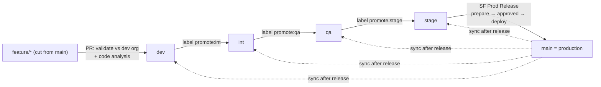

# How it works

## The model

- **Environments** come from `pipeline.config.yml`, in promotion order. Each has a long-lived branch
  (production's is `main`), an org, and its own secrets.
- **Feature branches are cut from `main`.** PRs enter at the first env. Later envs only accept
  *promotion PRs*, which SF Promote opens when you label a merged PR `promote:<next env>`.
  The same change therefore moves through every env as the same diff.
- **Deltas, never full deploys.** Every validation and deploy runs
  `sfdx-git-delta --from merge-base(origin/main, HEAD) --to HEAD`, which yields `package.xml` plus
  `destructiveChanges.xml`. The merge-base is the production baseline the change was built on, so
  changes that landed on `main` later never show up as phantom reverts.
- **Squash into env branches, merge commit into `main`.** Env branches require linear history. The
  release PR uses a merge commit so SHAs are preserved.
- **After every release**, env branches are reset to the new `main`. Branch protection is snapshotted,
  lifted, and restored exactly. The summary lists any unreleased commits the reset dropped, so they
  can be re-promoted.

## Required checks

Every env branch is protected (`bootstrap.py github`) and requires two commit statuses:

| Status | Posted by | Green when |
|---|---|---|
| `deploy-<env>` | SF PR Validation (gate) | Preflight passes, then the check-only validation passes (or there's no metadata to validate), and code analysis has no blocking findings |
| `sf-approval` | SF PR Approval | The PR has the `approved` label **or** `required_approvals` approving reviews (not from the author) |

Admins are included (`enforce_admins`), force pushes and deletions are blocked, and production
additionally needs the release workflow's own `deploy-prod`.

## Workflows

### SF PR Validation, on every PR into an env branch
1. **Plan** maps the base branch to an env. It skips non-env bases and release PRs (the release
   workflow validates those), then sets `deploy-<env>` to pending.
2. **Preflight** runs these checks together:
   - **PR routing:** features enter at the first env, later envs take only `promote/<env>/…`, `main`
     only takes `release/*`, and env branches are never merged into each other.
   - **Meta pairs:** every `.cls/.trigger/.page/.component` has its `-meta.xml`, and vice versa.
   - **Cut from main:** the PR carries no commits that exist only on another env branch.
   - **Change detection.**

   When a check fails, the PR comment quotes each problem and its fix, so nobody has to open the run
   log.
3. **Validate** logs in, computes the delta and resolves tests:
   - Each changed class/trigger maps to its companion test. A missing test fails fast and nothing is
     sent to the org.
   - It then runs `sf project deploy validate` (check-only). With `NoTestRun` it runs
     `deploy start --dry-run` instead, because `validate` rejects that test level.
4. **Code analysis** runs Salesforce Code Analyzer on the changed files. Findings at or above
   `severity_threshold` block.
5. **Gate** posts `deploy-<env>` and fails the run when red.

The config, scripts and composite actions always come from the default branch. The PR only supplies
the metadata, so a PR can't change its own rules.

### The PR report

Each PR gets a **🚀 Salesforce Pipeline Report** comment, which is updated in place:

- **Summary:** result, environment, delta range, test level and components.
- **Component failures:** shown as a table, and also as inline annotations on the changed lines.
- **Apex test failures:** with stack traces.
- **Coverage per changed class/trigger:** checked against `coverage_threshold`. A class that no test
  executed counts as 0%.
- **Salesforce coverage warnings.**
- **The delta manifest.**

Validation failures that the CLI reports as a bare error (only a job ID) are expanded with
`sf project deploy report`, so the details always appear. A separate **🔍 Code Analysis** comment
lists the findings. After the merge, the deploy's own report is added to the same PR, so one page
shows what was validated and what reached the org.

### SF PR Approval, on labels, reviews and pushes
- Posts `sf-approval` for open PRs into env branches.
- New commits remove the `approved` label (`dismiss_label_on_push`).
- Once a non-production PR is approved, it enables **auto-merge (squash)** with the pipeline token, so
  the PR merges itself as soon as validation is green. The merge's push then triggers the deploy.
  When two approved PRs merge into the same branch at once, GitHub refuses the second ("Base branch
  was modified"); the pipeline retries it.

### SF Env Deploy, on merge into a non-production env branch
- **Approval guard:** the PR behind the commit must be approved (label or reviews).
- **Deploy:** the cumulative delta (`merge-base(main, env HEAD)..HEAD`) is deployed with
  `sf project deploy start`.
- **Per-org lock:** one branch deploy at a time per org. A newer queued deploy supersedes an older
  one, which is safe because deploys are cumulative.
- **Skips:** merges without changes under `force-app`, and branches identical to `main` (just synced).
- **`deploy:<env>` label on an open PR:** a pre-merge test deploy of that PR's head into `<env>`. It
  also requires approval, and the label is removed afterwards.

### SF Promote, on a `promote:<env>` label on a merged PR
- Accepts only the next env (`enforce_order`) and never production.
- Opens `promote/<env>/pr-<n>`: the exact merged content plus an empty commit, so every promotion PR
  has its own head and statuses. The PR is opened with the pipeline token, so its validation runs.
- Re-running is safe: an open promotion PR, and any conflict resolution on it, is left untouched.
- A label that can't be applied (out of order, production, an unknown env) is removed, with a PR
  comment that says why.

### SF Prod Release, two phases
1. **Prepare** (run from `main`):
   - Cuts `release/<version>` from the env before production and opens a PR into `main`.
     Re-running with the same version refreshes it.
   - Validates check-only against production in the `production-validate` environment.
   - Records the result as an `sf-release-validation` status. `deploy-prod` stays **pending**, so the
     PR can't be merged by hand.
2. **Deploy**, triggered by adding `approved` to the release PR or running with `action=deploy`.
   It runs from `main`, in the `production` environment:
   - Checks that the validation status is from github-actions, the head is unchanged and the PR is
     approved.
   - Quick-deploys the validated job. It falls back to a full deploy only when Salesforce refuses the
     quick deploy.
   - Then sets `deploy-prod` green, merges the PR with a merge commit, tags, publishes a GitHub
     Release, syncs the env branches, and sends the chat notification.

Every step can be resumed. If a run stops after production was deployed, the next run finishes the
merge and tag **without deploying again**.

### Sync Env Branches
Runs after each release (or by hand). Each env branch:

1. Its unreleased commits are listed in the run summary.
2. Its protection is snapshotted (and saved as an artifact) and lifted.
3. It's force-pushed (with lease) to `main`.
4. Its protection is restored and verified. This step always runs.

The job runs in the protected `production-validate` environment, so an admin-capable token can live
there instead of in repository secrets.

### SF Rollback (manual)
Reverts a merged PR or commit as a **new PR** that flows through the pipeline like any change, so the
rollback is validated, approved, deployed and audited.
- `target: production`: the change is already in `main`. The revert is cut from `main` and enters
  at the first env, then is promoted and released.
- `target: <env>`: an unreleased change on that env branch is reverted there, and what it added is
  deleted from that env's org.
- The revert commit carries the name of whoever ran the rollback.

### Deploy safety nets (inside every validation and deploy)
- **Dependency lint:** deleting a component that other source still references (a class, field,
  picklist value…) fails before anything reaches the org.
- **Profiles / permission sets:** `deploy.profiles_mode: incremental` deploys only the permission
  entries added or changed since the production baseline.
- **Deletions already done:** deleting a component the target org doesn't have would fail with
  "No ApexClass named X found". That happens when env orgs lag behind each other, a component was
  removed by hand, or a validated release was already applied. The pipeline checks each deleted
  member against the org (`sf org list metadata`), skips the ones that are already gone, and lists
  them in the report. Folder-based types (reports, dashboards, documents, email templates) are always
  sent as they are.
- **Deletions on an env branch:** deltas start at `main`, so a component that was added and then
  removed on an env branch, without ever reaching `main` (an env rollback, for example), isn't a
  deletion relative to `main`. When a change is built on top of the env branch (the merge itself, or
  a rollback PR cut from that branch), the deploy also deletes what the change removed since the
  branch's previous head. Changes cut from `main` never have that head as an ancestor, so this can't
  delete other work that's only on the env branch. One limit: when three merges land in an env
  within one deploy, GitHub replaces the middle deploy, and a removal made only by that middle merge
  stays in the org.
- **Admin bypass:** the `bypass-quality-gates` label, added by an admin or maintainer, waives only
  the coverage and code-analysis gates.

### Audit trail, chat and Jira
- Every real deploy (env deploys and releases) writes one JSON record to the `audit-log` branch:
  who, what, where, commit, PR, components, coverage and Salesforce job ID.
- Outcomes can be posted to Slack, Microsoft Teams, Webex or any webhook (`notifications.chat`).
- Jira stories named in the branch, PR title or release notes are commented on and moved to each
  env's `jira_status` (`notifications.jira`).

### SF Pipeline Doctor (manual + weekly)
Logs in to every org from GitHub with the pipeline's secrets, and checks the token.

### Pipeline Self-Test, on PRs that change pipeline files
Runs config validation, the unit tests, and actionlint plus shellcheck.

## Concurrency

| What | Rule |
|---|---|
| PR validation | A new push cancels the PR's running validation. Title edits never do |
| Branch deploys | One per org at a time. GitHub keeps only the newest queued one, which is safe because deploys are cumulative |
| `deploy:<env>` label deploys | Their own group per PR, so they never cancel a branch deploy |
| Releases | Prepare and deploy share one group and never overlap |
| Sync | One at a time |

## Trust model

The protection keeps honest mistakes out: unreviewed merges, untested Apex, deploys of the wrong
artifact, merging a release that never reached production. It does **not** defend against a
malicious collaborator with write access. Anyone who can push a branch can change workflow files on
it, and GitHub then lets those workflows read repository secrets. For that reason:

- Production credentials live only in the protected `production`/`production-validate` environments.
- The env-branch sync can use a separate admin token kept in `production-validate`
  (`github.admin_pat_secret`).
- Add required reviewers to the `production` environment (`bootstrap.py github --reviewer <login>`)
  when more than one person can approve releases.
- Set `github.status_check_app_id: 15368` to accept required statuses only from GitHub Actions.
